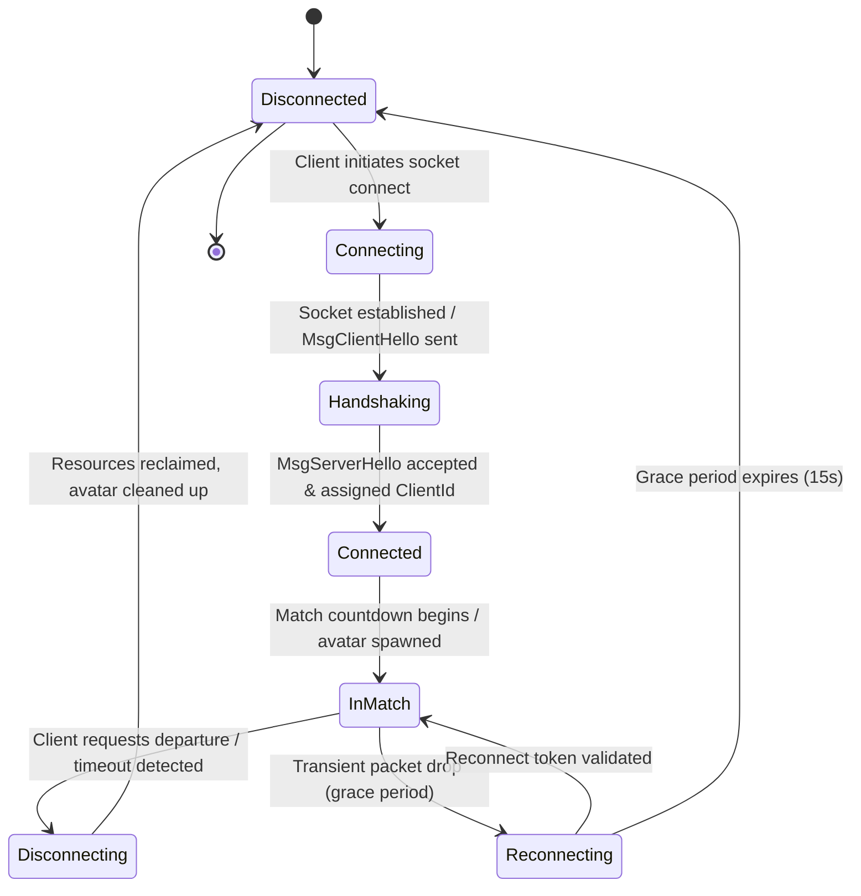

# WILDBOUND — NETWORK CONNECTION LIFECYCLE
## Handshake, Session States, Timeout Detection, Disconnects, and Reconnect Policies

**Document ID:** `WB-NET-015`  
**Phase:** 35 — Multiplayer Architecture & Server Authority Design  
**Author:** Wildbound Engine Architecture Team  
**Date:** 2026-11-07  
**Status:** Approved / Authoritative  

---

### 1. Connection Lifecycle State Machine

Each network connection transitions through a well-defined series of states:

---

### 2. State Descriptions & Transitions

#### 1. `Disconnected`
Initial default state. No network sockets or session memory allocated.

#### 2. `Connecting`
Client sends connection request to server IP:Port. Transport layer establishes preliminary peer context.

#### 3. `Handshaking`
- Client sends `MsgClientHello` containing protocol version (`1`), client build ID, and player token.
- Server validates protocol version. If mismatched, responds with `MsgConnectionRejected(VersionMismatch)` and closes socket.
- If compatible, server responds with `MsgServerHello` containing challenge salt and tick rate.

#### 4. `Connected`
Client completes challenge. Server registers participant in `MatchParticipantRegistry`, assigns a `ClientId`, spawns a player identity in the lobby, and returns `MsgConnectionAccepted`.

#### 5. `InMatch`
Player is actively participating in a match (countdown, active combat, or spectating). Heartbeats are sent every 1.0 second.

#### 6. `Reconnecting` (Transient Drop Grace Period)
If packets stop arriving from an active client for $> 3.0$ seconds:
- Connection enters `Reconnecting`.
- The player avatar is flagged as **Disconnected Avatar** (stands idle in the world with a disconnect indicator above its head).
- The player avatar **remains physically present in the world** for up to $15.0$ seconds. It can still take damage and be eliminated by enemies or the corruption storm.
- If the client reconnects within $15.0$ seconds with a matching session token, control is restored seamlessly.
- If $15.0$ seconds elapse without reconnection, the avatar is eliminated (`EliminationCause::Disconnected`) and death loot drops.

#### 7. `Disconnecting`
Graceful departure. Client sends `MsgDisconnectRequest`. Server unregisters participant, notifies squad mates, and cleanly closes socket.

---

### 3. Edge Cases & Policies

| Scenario | Server Policy / Behavior |
|---|---|
| **Disconnect during Countdown** | Participant slot is immediately vacated; countdown restarts or continues depending on minimum player count. |
| **Disconnect during Active Combat** | Avatar remains in world for 15s grace window; player cannot "combat log" to avoid death. |
| **Disconnect after Elimination** | Clean immediate disconnect; client enters post-match summary screen locally. |
| **Server Shutdown / Crash** | Server sends broadcast `MsgDisconnectRequest(ServerShutdown)`; clients return to main menu with alert dialog. |
| **Duplicate Connection (Same Token)** | Old connection is forcefully terminated with `MsgConnectionRejected(DuplicateLogin)`; new connection takes over. |
| **Packet Flood / DoS Attempt** | If client sends $> 100$ packets/sec, server rate-limits and drops connection. |

