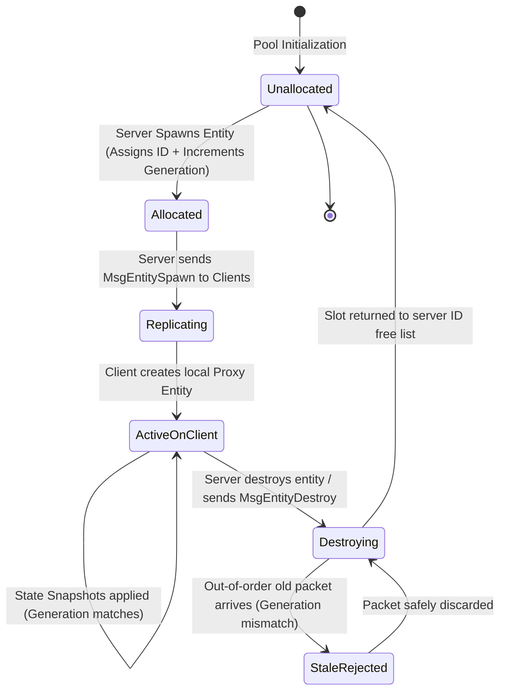

# WILDBOUND — NETWORK ENTITY IDENTITY SPECIFICATION
## Stable Network IDs, Generational Handles, and Lifecycle Invalidation

**Document ID:** `WB-NET-005`  
**Phase:** 35 — Multiplayer Architecture & Server Authority Design  
**Author:** Wildbound Engine Architecture Team  
**Date:** 2026-11-07  
**Status:** Approved / Authoritative  

---

### 1. The Entity Identity Challenge in Distributed Games

In an offline engine, pointers (`Enemy*`, `Player*`) or raw local array indices (`items[5]`) are used to reference objects in memory. In a distributed multiplayer architecture:
1. Pointers cannot be transmitted across networks (differing virtual address spaces).
2. Local entity indices diverge between server and different clients.
3. High packet latency or packet loss can cause an update for a destroyed entity to arrive *after* that slot has been reassigned to a newly spawned entity. Without generational validation, the new entity would erroneously apply the old update (the "stale entity reference" bug).

To solve this, Wildbound introduces the **Generational Network Entity Identity**.

---

### 2. Network Identity Data Structures

```cpp
namespace wildbound::network {

/// Strong type wrapper for 32-bit network entity ID
struct NetworkEntityId {
    uint32_t value = 0;

    [[nodiscard]] constexpr bool IsValid() const noexcept { return value != 0; }
    [[nodiscard]] constexpr auto operator<=>(const NetworkEntityId&) const = default;
};

/// 64-bit combined identity: ID (32 bits) + Generation (32 bits)
struct NetworkEntityIdentity {
    NetworkEntityId id{ 0 };
    uint32_t generation{ 0 };

    [[nodiscard]] constexpr bool IsValid() const noexcept {
        return id.IsValid() && generation > 0;
    }

    [[nodiscard]] constexpr uint64_t ToHandle() const noexcept {
        return (static_cast<uint64_t>(generation) << 32) | static_cast<uint64_t>(id.value);
    }

    [[nodiscard]] static constexpr NetworkEntityIdentity FromHandle(uint64_t handle) noexcept {
        return NetworkEntityIdentity{
            .id = NetworkEntityId{ static_cast<uint32_t>(handle & 0xFFFFFFFF) },
            .generation = static_cast<uint32_t>(handle >> 32)
        };
    }

    [[nodiscard]] constexpr auto operator<=>(const NetworkEntityIdentity&) const = default;
};

} // namespace wildbound::network
```

---

### 3. Identity Lifecycle State Machine



#### Lifecycle Step Details
1. **Creation & Allocation**: When the authoritative server spawns an entity (e.g. a player, bot, loot container, or projectile), it pulls an available ID slot from the `NetworkIdentityTable`. The slot's `generation` counter is incremented by 1.
2. **Spawn Replication**: The server broadcasts `MsgEntitySpawn` containing `(NetworkEntityIdentity, EntityType, Position, InitialComponents)`.
3. **Client Instantiation**: Upon receipt, each client checks if it already knows this identity. If not, it allocates a local proxy entity and registers `NetworkEntityIdentity -> LocalEntityPtr` in its local lookup table.
4. **State Replication & Validation**: All subsequent snapshots reference `NetworkEntityIdentity`. If a packet arrives with a generation lower than the current generation registered for that ID, the update is **rejected as stale**.
5. **Destruction & Invalidation**: When an entity is destroyed on the server, a reliable `MsgEntityDestroy` is dispatched. The server frees the ID slot for reuse, but its generation remains incremented. The client immediately marks its local proxy as invalid and frees resources.

---

### 4. Which Game Objects Require Network Identities?

Not every object in the game world requires a network identity. Replicating static or purely client-side decorative elements wastes bandwidth and CPU cycles:

| World Object Category | Network Identity Required? | Rationale |
|---|---|---|
| **Human Players** | **YES** | Core dynamic participants; continuous transform, health, and combat replication. |
| **AI Bot Competitors** | **YES** | Dynamic combatants; movement and actions replicated to clients. |
| **Ranged Projectiles** | **YES** | Dynamic trajectory entities; hit events must correlate to authoritative projectile IDs. |
| **Ground Loot Drops** | **YES** | World items that players can pick up; must have unique IDs for pickup requests. |
| **Loot Containers (Chests)** | **YES** | State changes (closed $\to$ opened) must replicate to prevent duplicate looting. |
| **Interactive Doors / Levers** | **YES** | World mechanisms with dynamic open/closed states. |
| **Static Trees, Rocks, Buildings** | **NO** | Deterministically loaded from map TMX file on each machine. |
| **Particle & Visual Effects** | **NO** | Client-side visual fluff spawned deterministically from replicated events. |
| **Water Waves, Wind Grass** | **NO** | Procedural environmental animations computed locally in shader/update logic. |

---

### 5. ID Range Allocation

To prevent collisions between different entity types and simplify debugging, 32-bit `NetworkEntityId` values are partitioned:

| ID Range | Assigned Subsystem / Entity Class | Max Concurrency |
|---|---|---|
| `0x00000000` | **Reserved (Invalid Sentinel)** | 1 |
| `0x00000001` – `0x000000FF` | **Human Player Participants** | 255 |
| `0x00000100` – `0x00000FFF` | **AI Bot Competitors** | 3,840 |
| `0x00001000` – `0x00007FFF` | **Loot Containers & Ground Items** | 28,672 |
| `0x00008000` – `0x0000FFFF` | **Doors, Mechanisms & World Objects** | 32,768 |
| `0x00010000` – `0x00FFFFFF` | **Dynamic Projectiles & Temporary Spawns** | 16,711,680 |
| `0x01000000` – `0xFFFFFFFF` | **Reserved for Future Expansion** | 4.2 Billion |

