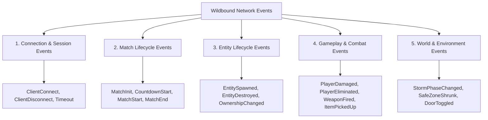

# WILDBOUND — NETWORK EVENT SYSTEM SPECIFICATION
## Event Classification, Sequencing, Validation, and Dispatching

**Document ID:** `WB-NET-006`  
**Phase:** 35 — Multiplayer Architecture & Server Authority Design  
**Author:** Wildbound Engine Architecture Team  
**Date:** 2026-11-07  
**Status:** Approved / Authoritative  

---

### 1. Overview & Event Taxonomy

Network events in Wildbound represent discrete occurrences that alter state or trigger audiovisual feedback. Unlike continuous state replication (e.g. position streams), network events are **action-oriented, sequenced, and categorized by reliability requirements**.



---

### 2. Event Classification Matrix

| Event Name | Category | Direction | Channel | Reliability | Action Triggered on Recipient |
|---|---|---|---|---|---|
| `EvtClientConnected` | Connection | S $\to$ C | Control | Reliable | Updates lobby roster UI |
| `EvtClientDisconnected` | Connection | S $\to$ C | Control | Reliable | Removes player avatar, logs departure |
| `EvtMatchCountdown` | Match | S $\to$ C | Match State | Reliable | Starts UI countdown overlay & chime |
| `EvtMatchStarted` | Match | S $\to$ C | Match State | Reliable | Unlocks player movement & spawning |
| `EvtMatchCompleted` | Match | S $\to$ C | Match State | Reliable | Freezes combat, shows victory screen |
| `EvtEntitySpawned` | Entity | S $\to$ C | Replication | Reliable | Allocates client entity proxy |
| `EvtEntityDestroyed` | Entity | S $\to$ C | Replication | Reliable | Frees client entity proxy |
| `EvtAttackRequest` | Gameplay | C $\to$ S | Events | Reliable | Server checks cooldowns & hits |
| `EvtWeaponFired` | Gameplay | S $\to$ C | Events | Unreliable / Sequenced | Plays remote muzzle flash / sound |
| `EvtDamageApplied` | Gameplay | S $\to$ C | Events | Reliable | Shows damage floaters & blood FX |
| `EvtPlayerEliminated` | Gameplay | S $\to$ C | Events | Reliable | Adds killfeed entry, spawns death crate |
| `EvtPickupRequest` | Gameplay | C $\to$ S | Events | Reliable | Server verifies distance & grants item |
| `EvtItemCollected` | Gameplay | S $\to$ C | Events | Reliable | Removes ground item, adds to inventory |
| `EvtStormPhaseShift` | World | S $\to$ C | Match State | Reliable | Triggers siren SFX, updates minimap |

---

### 3. Event Envelope & Data Structure

Every network event is wrapped in a standard, fixed-header envelope:

```cpp
namespace wildbound::network {

enum class NetworkEventCategory : uint8_t {
    Connection = 0,
    Match      = 1,
    Entity     = 2,
    Gameplay   = 3,
    World      = 4
};

enum class NetworkEventType : uint16_t {
    None = 0,
    // Connection
    ClientConnected, ClientDisconnected, AuthChallenge,
    // Match
    MatchCountdown, MatchStarted, MatchCompleted,
    // Entity
    EntitySpawned, EntityDestroyed, EntityOwnershipAssigned,
    // Gameplay
    AttackRequest, WeaponFired, DamageApplied, PlayerEliminated,
    PickupRequest, ItemCollected, ItemDropped,
    // World
    StormPhaseShift, DoorToggled, ContainerOpened
};

struct NetworkEventEnvelope {
    uint32_t sequenceNumber{ 0 };     // Incremental event ID
    uint32_t senderClientId{ 0 };     // Client ID of originator (0 for server)
    NetworkEntityIdentity actorId{};  // Entity executing the action
    NetworkEventType eventType{ NetworkEventType::None };
    NetworkEventCategory category{ NetworkEventCategory::Gameplay };
    uint64_t serverTimestampMs{ 0 };  // Exact server wall-clock time
    uint16_t payloadSize{ 0 };        // Length of payload bytes
};

} // namespace wildbound::network
```

---

### 4. Event Validation & Anti-Tamper Pipeline

When the server receives a client-to-server request event (e.g. `EvtAttackRequest`, `EvtPickupRequest`):

1. **Client Identity Check**: Does `senderClientId` match the authenticated socket connection from which the packet was received? (Rejects spoofed client IDs).
2. **Actor Ownership Check**: Does `actorId` belong to the player avatar assigned to that client? (A client cannot trigger an attack on behalf of another player or bot).
3. **Sequence Strictness**: Is the event sequence number strictly greater than the last processed event for that connection? (Prevents replay attacks).
4. **Action Feasibility**:
   - For an attack: Is the player alive? Is the weapon equipped? Is stamina > 0? Has the weapon cooldown elapsed?
   - For a pickup: Is the item within $64$ units of the player? Is the player's inventory below max capacity?
5. **Authoritative Execution**: If all 4 checks pass, the server executes the action internally and broadcasts resulting authoritative notifications to all interested clients.

