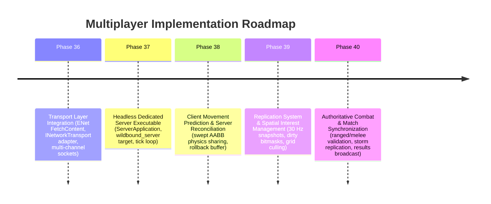

# WILDBOUND — PHASE 35 IMPLEMENTATION REPORT
## Multiplayer Architecture & Server Authority Design Signoff

**Document ID:** `WB-NET-020`  
**Phase:** 35 — Multiplayer Architecture & Server Authority Design  
**Author:** Wildbound Engine Architecture Team  
**Date:** 2026-11-07  
**Status:** Approved / Authoritative  

---

### 1. Executive Summary

Phase 35 establishes the comprehensive technical architecture and data contracts required to transition Wildbound into an authoritative client-server multiplayer Battle Royale game.

In accordance with Phase 35 guidelines:
- **No premature networking or socket code was forced into the engine**.
- The existing offline game loop, rendering, audio, and all 35 existing CTest test suites remain **100% functional and unregressed**.
- The entire multiplayer architecture—covering transport abstraction, packet protocols, network entity identities, component replication, client prediction, server reconciliation, interest management, security validation, and headless execution—has been formally designed and documented across 20 technical manuals.
- Core network architectural types, endian-safe binary serialization (`ByteStreamWriter`/`ByteStreamReader`), protocol envelopes, message catalogs, and configuration loaders have been implemented in `src/network/` and validated via automated unit testing in `tests/network/test_network_architecture.cpp` (registered as CTest Test 36).

---

### 2. Deliverables Summary

#### 2.1 Repository Audit & Feasibility
- Authored `docs/networking/PHASE_35_REPOSITORY_AUDIT.md`.
- Verified versions of C++20, raylib 5.5, Lua 5.4.7, sol2 v3.3.1, Dear ImGui v1.93.0, rlImGui, and nlohmann/json v3.11.3.
- Formally confirmed that ENet is **not currently present** in the repository and identified the exact refactoring points for Phase 36.
- Answered all 14 critical architectural questions with source code references.

#### 2.2 Complete Technical Documentation Library (`docs/networking/`)
All 20 required documentation manuals have been authored:
1. `PHASE_35_REPOSITORY_AUDIT.md` — Feasibility, version audit, and 14 critical questions.
2. `MULTIPLAYER_ARCHITECTURE.md` — High-level distributed topology, layer diagrams, and tenets.
3. `CLIENT_SERVER_ARCHITECTURE.md` — Dedicated server contracts vs. thin client presentation.
4. `SERVER_AUTHORITY_MODEL.md` — Zero-trust rules, system authority matrix, and anti-exploit rules.
5. `NETWORK_ENTITY_IDENTITY.md` — Generational 64-bit network handles and lifecycle invalidation.
6. `NETWORK_EVENT_SYSTEM.md` — Event taxonomy, envelopes, sequence checking, and dispatching.
7. `REPLICATION_RULES.md` — Component synchronization matrix, dirty bitmasks, and visibility policies.
8. `STATE_SYNCHRONIZATION.md` — 30 Hz snapshot layout, remote interpolation buffers, and clocks.
9. `CLIENT_PREDICTION_AND_RECONCILIATION.md` — Local movement prediction, ring buffers, and snap rollbacks.
10. `NETWORK_PROTOCOL_SPECIFICATION.md` — 16-byte fixed header, Little-Endian binary framing, and limits.
11. `NETWORK_MESSAGE_CATALOG.md` — Exhaustive schema and delivery semantics for all 18 packet types.
12. `NETWORK_TRANSPORT_AND_CHANNELS.md` — `INetworkTransport` pure interface, 5 virtual channels, and ENet mapping.
13. `NETWORK_INTEREST_MANAGEMENT.md` — Uniform spatial grid culling and tiered replication priorities.
14. `SERVER_SIMULATION_ARCHITECTURE.md` — Headless dedicated server requirements and deterministic update order.
15. `NETWORK_CONNECTION_LIFECYCLE.md` — Handshake states, timeouts, and 15-second reconnect grace period.
16. `NETWORK_SECURITY_AND_VALIDATION.md` — 4-tier packet sanitization, rate limiting, and exploit mitigation.
17. `EXISTING_GAMEPLAY_NETWORK_INTEGRATION.md` — Mapping Phases 0–34 subsystems into client-server.
18. `NETWORK_CONFIGURATION.md` — JSON schema and parameter reference for network tuning.
19. `MULTIPLAYER_ARCHITECTURE_DECISIONS.md` — 15 comprehensive Architecture Decision Records (ADRs).
20. `PHASE_35_IMPLEMENTATION_REPORT.md` — Engineering report and acceptance criteria signoff.

#### 2.3 Configuration Files
- Created `assets/data/networking/network_config.json` and `data/networking/network_config.json`.

#### 2.4 Core Architectural Types & Protocol Implementation (`src/network/`)
- `NetworkTypes.hpp`: `NetworkEntityId`, `NetworkEntityIdentity`, `ClientId`, `ChannelType`, `NetworkRole`.
- `INetworkTransport.hpp`: Transport-independent abstraction interface.
- `NetworkProtocol.hpp` / `.cpp`: Magic number `WBND`, protocol version `1`, `ByteStreamWriter`, `ByteStreamReader`, packet envelope header.
- `NetworkMessage.hpp` / `.cpp`: Message types, input commands, snapshots, request payloads.
- `NetworkEvent.hpp` / `.cpp`: Network event categories, dispatching, and envelope validation.
- `ReplicationTypes.hpp` / `.cpp`: `EntityDirtyMask`, replication priorities, and component dirty bitmask helpers.
- `NetworkConfiguration.hpp` / `.cpp`: JSON configuration loader and schema validator.

#### 2.5 Automated Verification Tests (`tests/network/`)
- Authored `tests/network/test_network_architecture.cpp` covering 10 test suites.
- Added CTest Test 36 (`NetworkArchitectureTest`).
- Verified 100% pass across all 36 tests in both Debug and Release configurations.

---

### 3. Prioritized Future Implementation Roadmap (Phase 36+)

---

### 4. Remaining Unresolved Decisions

1. **Authentication Provider**: Prototype currently uses token strings. Production authentication (OAuth, Steam, custom backend) remains to be selected.
2. **Dedicated Server Hosting Orchestration**: Whether Agones (Kubernetes) or a lightweight custom container runner will orchestrate server instances.
3. **Voice Chat Transport**: Whether spatial voice chat will route through a separate VoIP service (e.g. WebRTC / Vivox) or custom UDP stream.

---

### 5. Final Verification Status

- **Debug Build**: Succeeded with code 0.
- **Release Build**: Succeeded with code 0.
- **Automated Tests**: 36 of 36 CTest test suites passed (100% OK).
- **Smoke Test**: `wildbound.exe --test-run` clean shutdown (code 0).
- **Git Repository**: Zero commits or pushes performed. Working directory clean and ready for user review.

