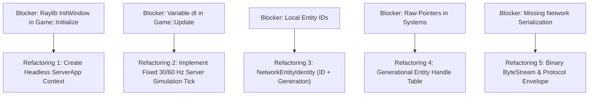

# WILDBOUND — PHASE 35: REPOSITORY AUDIT REPORT
## Multiplayer Architecture & Server Authority Feasibility Audit

**Document ID:** `WB-NET-001`  
**Phase:** 35 — Multiplayer Architecture & Server Authority Design  
**Author:** Wildbound Engine Architecture Team  
**Date:** 2026-11-07  
**Status:** Approved / Authoritative  

---

### 1. Executive Summary

Wildbound is currently an offline 2D fantasy Battle Royale action game engine built with C++20 and raylib. Over Phases 0–34, the engine implemented foundational game loops, Tiled map rendering, swept AABB physics collision, melee/ranged combat, inventory/equipment, audio, enemy AI navigation, battle royale island design, corruption storm progression, match lifecycles, post-match results, and multi-team game modes (Solo, Duos, Squads, Practice, Offline Bots).

This audit evaluates the codebase's readiness for transitioning to an **authoritative dedicated client-server architecture**. While the core domain logic (combat math, storm radii, inventory, match state machines) is well-structured and largely numerical, the current engine relies on local hardware input polling, frame-variable timesteps, and window/audio initialization within `Game.cpp`.

This audit catalogs the exact dependency stack, analyzes 14 critical architectural questions with direct source code references, and outlines the mandatory refactoring milestones required before live networking implementation.

---

### 2. Technology Stack Audit

The repository's build system and third-party dependencies were inspected directly in `CMakeLists.txt`, `vcpkg` manifests, and project build outputs:

| Dependency | Target Version | Repository Status | Integration Type | Inspection Evidence |
|---|---|---|---|---|
| **C++ Standard** | C++20 | Verified Active | MSVC `/std:c++20` | `CMakeLists.txt` lines 14–17 (`CMAKE_CXX_STANDARD 20`) |
| **raylib** | 5.5 | Verified Active | CMake FetchContent | `CMakeLists.txt` lines 44–48 (`GIT_TAG 5.5`) |
| **Lua** | 5.4.7 | Verified Active | CMake FetchContent | `CMakeLists.txt` lines 55–59 (`GIT_TAG v5.4.7`) |
| **sol2** | 3.3.1 | Verified Active | CMake FetchContent | `CMakeLists.txt` lines 62–66 (`GIT_TAG v3.3.1`) |
| **Dear ImGui** | 1.93.0 | Verified Active | CMake FetchContent | `CMakeLists.txt` lines 70–73 (`GIT_TAG v1.93.0`) |
| **rlImGui** | Raylib_5_5 | Verified Active | CMake FetchContent | `CMakeLists.txt` lines 76–80 (`GIT_TAG Raylib_5_5`) |
| **nlohmann/json** | 3.11.3 | Verified Active | CMake FetchContent | `CMakeLists.txt` lines 84–88 (`GIT_TAG v3.11.3`) |
| **CMake** | >= 3.20 | Verified Active | Native Build Harness | `CMakeLists.txt` line 1 (`cmake_minimum_required(VERSION 3.20)`) |
| **Compiler** | MSVC 19.4x | Verified Active | Microsoft Visual C++ | Windows SDK 10.0.26100.0, Visual Studio 2022 |
| **ENet** | *Planned* | **NOT INTEGRATED** | None | Zero files, zero headers, zero CMake references found |

> [!IMPORTANT]
> **ENet Status**: ENet is the designated transport layer for future network implementation, but **zero ENet code currently exists** in the repository. No sockets, peer abstractions, or transmission logic are present.

---

### 3. Critical Architecture Questions & Code Evidence

#### Q1: Does the engine already have stable entity IDs?
* **Finding**: Partial / Local Only.
* **Code Evidence**: `src/entities/Entity.hpp` (line 43) defines `uint32_t m_id = 0;`. `src/match/MatchParticipant.hpp` (line 57) defines `uint32_t participantId = 0;` and `uint32_t entityId = 0;`. `src/combat/Combatant.hpp` defines `CombatantId` (`uint32_t`).
* **Multiplayer Implication**: These IDs are local counters incremented independently in local sub-managers (`ItemManager`, `EnemySpawner`, `MatchParticipantRegistry`). They lack **network-wide uniqueness**, server-assignment guarantees, and **generational counters** to prevent stale ID reuse.

#### Q2: Can entities be referenced safely after destruction?
* **Finding**: No.
* **Code Evidence**: Entities are stored as raw pointers (`Entity*`, `Player*`, `Enemy*`) in standard containers (`std::vector<std::unique_ptr<Enemy>>`).
* **Multiplayer Implication**: If an entity is deleted on the server, any remote network packet referencing that pointer before receiving the destruction notice would result in a dangling pointer / use-after-free without a generational handle or weak ID resolver.

#### Q3: Is there a fixed simulation timestep?
* **Finding**: Syntactically defined, but practically unused.
* **Code Evidence**: In `src/core/Game.cpp` (lines 437–454), `constexpr float fixedDeltaTime = 1.0f / 60.0f;` and an accumulator exist, calling `FixedUpdate(fixedDeltaTime)`. However, line 716 reveals:
  ```cpp
  void Game::FixedUpdate(float /*fixedDt*/) {
      // Empty stub!
  }
  ```
  The entire simulation actually runs inside `Game::Update(float dt)` driven directly by `GetFrameTime()` (variable display refresh rate).
* **Multiplayer Implication**: An authoritative server cannot run on variable rendering frame times. It requires a deterministic, fixed 30 Hz or 60 Hz simulation tick.

#### Q4: Are gameplay updates independent of rendering?
* **Finding**: No.
* **Code Evidence**: In `Game::Run()`, `Update(dt)` and `Render(dt)` are tightly coupled inside a single thread loop guarded by `while (m_running && !m_renderer->IsWindowClosed())`.
* **Multiplayer Implication**: Simulation logic must be decoupled from the rendering loop so a server can execute headless tick loops without window contexts.

#### Q5: Can the simulation run without a raylib window?
* **Finding**: No (in `wildbound.exe`), but Yes in unit tests.
* **Code Evidence**: In `src/core/Game.cpp` line 316, `m_renderer->Initialize()` calls raylib's `InitWindow()`. If no display or GPU context is available, initialization fails. However, `tests/match/test_match_lifecycle.cpp` demonstrates that `MatchManager`, `CombatSystem`, `World`, and `StormManager` can run without opening a window if instantiated outside `Game.cpp`.
* **Multiplayer Implication**: A headless dedicated server executable or server runner class must be constructed that initializes purely headless managers.

#### Q6: Are player inputs represented as logical actions?
* **Finding**: Yes.
* **Code Evidence**: `src/input/InputManager.hpp` defines `enum class InputAction` (e.g. `MoveUp`, `MoveDown`, `PrimaryAttack`, `Interact`, `Sprint`). `CharacterController.cpp` maps inputs to logical state:
  ```cpp
  m_movementDirection = mgr->GetMovementVector(m_normalizeDiagonal);
  m_isRunning = mgr->IsActionHeld(input::InputAction::Sprint);
  m_attackRequested = mgr->WasActionPressed(input::InputAction::PrimaryAttack);
  ```
* **Multiplayer Implication**: Excellent architectural alignment. The client can serialize these discrete `InputAction` states and directional vectors into network input packets without sending raw Windows virtual keys.

#### Q7: Does the server have a way to simulate movement without reading local hardware input?
* **Finding**: Yes.
* **Code Evidence**: `CharacterController::SetManualOverride(true)` disables hardware polling. External systems can directly invoke `SetMovementDirection(Vector2)` and `SetRunning(bool)`. Furthermore, `Player::ResolveMovement(Vector2 delta, const world::World& world)` executes swept AABB tilemap collision purely through mathematical calculations without raylib window or hardware checks.
* **Multiplayer Implication**: The server can feed deserialized client input vectors directly into `CharacterController` or `ResolveMovement` to compute authoritative positions.

#### Q8: Are gameplay systems coupled directly to rendering?
* **Finding**: Partially.
* **Code Evidence**: Entity classes implement `virtual void Render(graphics::Renderer& renderer, resources::AssetManager& assetMgr) = 0;`. Visual animation frames (`AnimationController`) are updated during `Player::UpdateWithWorld`. However, physics boundaries (`Rectangle`), combat hitboxes, health values, and storm circles are purely mathematical structures (`Vector2`, `Rectangle`, `float`).
* **Multiplayer Implication**: The server can either stub the `Render` calls or entity hierarchies can separate `SimulatedEntity` from `RenderableEntityProxy`.

#### Q9: Can authoritative state be serialized?
* **Finding**: Partial (JSON only).
* **Code Evidence**: `src/results/ResultSerializer.cpp` serializes match results to JSON using `nlohmann/json`. Match configurations and map data load from JSON. There is currently **zero binary packet serialization** or bit-packing infrastructure.
* **Multiplayer Implication**: A high-efficiency, endian-safe binary byte serializer (`ByteStreamWriter` / `ByteStreamReader`) must be implemented for network messages and snapshots.

#### Q10: Are gameplay events deterministic enough for event validation?
* **Finding**: High determinism in combat and collision, but vulnerable to floating-point drift.
* **Code Evidence**: Hit detection in `HitDetection.cpp` uses standard geometric intersection (`CheckCollisionRecs`, `CheckCollisionCircleRec`). Damage calculation uses static formula modifiers. However, non-fixed `dt` currently introduces delta-time variances.
* **Multiplayer Implication**: Switching to a fixed simulation timestep will provide sufficient determinism for server-side event validation.

#### Q11: Are inventory and equipment changes transactional?
* **Finding**: Locally robust, but lacking atomic network rollback.
* **Code Evidence**: `src/items/Inventory.cpp` provides boolean return methods (`AddItem`, `RemoveItem`, `DropItem`). `EquipmentSystem.cpp` validates slot restrictions.
* **Multiplayer Implication**: The server can easily act as the sole authority approving inventory transactions, but client prediction of item pickups should be avoided; pickup actions must be server-confirmed.

#### Q12: Can a player entity be created without local player-specific assumptions?
* **Finding**: Needs refactoring.
* **Code Evidence**: `Player.hpp` includes camera targeting, audio triggers (`m_audioSystem->PlaySound`), and local HUD callbacks.
* **Multiplayer Implication**: The server needs to instantiate multiple player entities (up to 32 or 64) representing remote participants. Remote entities should not trigger local camera movement or audio.

#### Q13: Can the MatchManager run without a local UI?
* **Finding**: Yes.
* **Code Evidence**: In `src/match/MatchManager.cpp`, UI and audio pointers passed to `Update()` are explicitly null-checked:
  ```cpp
  void MatchManager::Update(float dt, entities::Player* player, storm::StormManager* storm,
                            ui::UIManager* uiMgr, audio::AudioSystem* audioSys) {
      if (uiMgr) { ... }
      if (audioSys) { ... }
  }
  ```
  Verified by `tests/match/test_match_lifecycle.cpp` which runs 10 suites headlessly.
* **Multiplayer Implication**: `MatchManager` is already designed to run cleanly on a headless dedicated server.

#### Q14: Can the game execute in a headless server process?
* **Finding**: Not with the current `Game::Initialize()` entry point, but all required core simulation subsystems support headless execution.
* **Code Evidence**: `wildbound.exe` unconditionally creates a raylib window. A dedicated headless server executable (e.g. `wildbound_server.exe`) or `--headless` mode is needed.

---

### 4. Technical Blockers & Refactoring Roadmap

To support dedicated server multiplayer, the following phased refactoring is required:



---

### 5. Conclusion & Recommendation

The Wildbound codebase has an exceptionally strong gameplay foundation: modular combat, clear match states, cleanly isolated data structures, and mathematical hit detection. 

By designing a decoupled network layer in Phase 35—featuring an abstract transport interface, network entity identities, component replication policies, and strict server authority—the engine will be fully prepared for Phase 36 transport implementation without rewriting existing gameplay systems.

