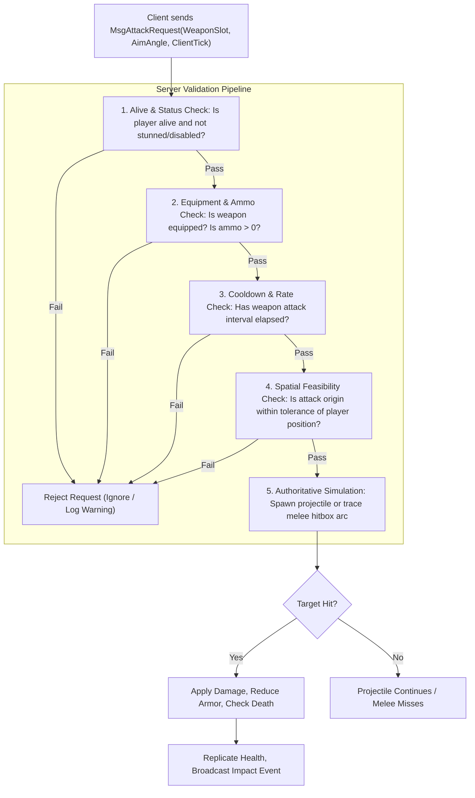

# WILDBOUND — SERVER AUTHORITY MODEL & TRUST BOUNDARIES
## Authoritative Verification, Trust Matrix, and Anti-Exploit Principles

**Document ID:** `WB-NET-004`  
**Phase:** 35 — Multiplayer Architecture & Server Authority Design  
**Author:** Wildbound Engine Architecture Team  
**Date:** 2026-11-07  
**Status:** Approved / Authoritative  

---

### 1. The Zero-Trust Security Principle

In Wildbound, **all incoming network packets from clients are treated as untrusted user input**. The server assumes the client executable could be modified, instrumented with a memory debugger, or spoofed by malicious scripts.

#### Golden Rules of Server Authority
1. **Never Accept Assertions of Reality**: The server never accepts messages stating a result (e.g. `MsgPlayerDamaged`, `MsgItemPickedUp`, `MsgPlayerDied`). It only accepts messages expressing *intent* (e.g. `MsgAttackRequest`, `MsgPickupRequest`).
2. **All Actions Must Be Validated Against Server State**: The server checks physical constraints (range, line-of-sight, cooldowns, resources) before executing any requested action.
3. **The Server Computes All State Transitions**: The server decrements health, increments ammo consumption, triggers storm eliminations, and determines placements.

---

### 2. Comprehensive System Authority Matrix

| Game System | Authoritative Owner | Client Role | Validation Performed by Server |
|---|---|---|---|
| **Player Position & Speed** | **Server** | Local prediction | Max speed clamp, swept AABB tile collision, teleportation distance checks. |
| **Facing & Aim Angle** | **Client Intent / Server State** | Controls aim direction | Clamped to normalized radians $[0, 2\pi)$. |
| **Melee Attacks** | **Server** | Speculative visual swing | Weapon equipped, attack cooldown expired, stamina/energy check, target within arc. |
| **Ranged Attacks** | **Server** | Speculative tracer bullet | Ammo check, weapon cooldown, max rate-of-fire enforcement, line-of-sight. |
| **Hit Detection** | **Server** | None (purely cosmetic impacts) | Authoritative projectile-to-AABB collision check at server time. |
| **Damage Calculation** | **Server** | Displays damage numbers | Base weapon damage $\times$ crit modifier $-$ armor damage reduction. |
| **Health & Death** | **Server** | Displays health bar | Zero threshold evaluation, death transition, elimination recording. |
| **Loot Pickup** | **Server** | Requests pickup on interact | Proximity check ($\le 64$ units), item existence, container inventory capacity. |
| **Inventory & Equipment** | **Server** | Displays UI slots | Item ownership, slot compatibility, stacking limits, weight limits. |
| **Corruption Storm** | **Server** | Visual storm barrier shader | Phase timer, center lerp, radius shrinkage, periodic damage application. |
| **Team Membership** | **Server** | Displays squad badges | Team capacity limits, friendly-fire immunity enforcement. |
| **Match State & Timer** | **Server** | Displays timer & banners | State machine transitions (`Countdown`, `Active`, `Finishing`, `Completed`). |
| **Victory & Defeat** | **Server** | Displays victory screen | Last-surviving-participant or last-surviving-squad evaluation. |
| **Match Results** | **Server** | Displays stats summary | Immutable snapshot generation, rank placement, persistence to disk. |

---

### 3. Attack Verification Pipeline

When a client initiates a combat action, the server processes it through a strict 5-stage validation pipeline:

---

### 4. Movement Validation & Anti-Speedhack Rules

Client movement is validated every tick using the server's authoritative timestep $\Delta t$:

1. **Maximum Velocity Verification**:
   Let the maximum allowed speed for the player's current equipment and state be $V_{\max}$ (e.g. $180$ units/sec walking, $260$ units/sec sprinting).
   The maximum physical distance allowed over elapsed time $\Delta t$ is:
   $$D_{\max} = V_{\max} \cdot \Delta t \cdot (1.0 + \epsilon)$$
   where $\epsilon = 0.10$ ($10\%$ tolerance to account for network transmission jitter).
2. **Teleportation Detection**:
   If the displacement between client requested position $\mathbf{P}_{\text{req}}$ and previous server position $\mathbf{P}_{\text{prev}}$ exceeds $D_{\max}$, the request is rejected, the position is snapped to the server's collision-resolved coordinate, and a reconciliation correction packet is dispatched.
3. **Collision Penetration Prevention**:
   The server resolves all movement using the authoritative `world::World` swept AABB collision system. A client cannot clip through walls or obstacles regardless of what local position it predicts.

---

### 5. Information Security (Anti-Wallhack & Anti-ESP)

To prevent cheat software from reading hidden opponents from client memory:
- **Spatial Fog of War**: The server never transmits entity snapshots for players outside a client's interest radius or behind solid occluding terrain.
- **Private Inventory Data**: Other players' backpack contents are never replicated to competing clients.
- **Hidden Bot AI State**: Bot decision trees and internal targets are purely server-side.

