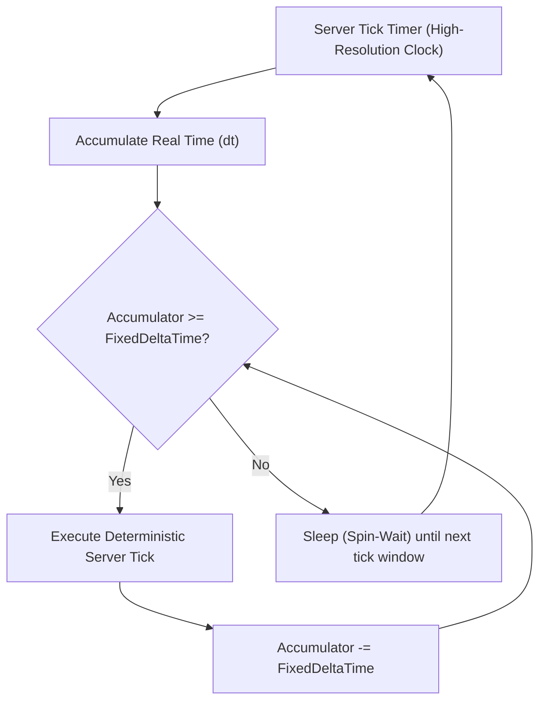

# WILDBOUND — SERVER SIMULATION ARCHITECTURE
## Headless Dedicated Simulation, Fixed Tick Loop, and Authoritative Update Sequence

**Document ID:** `WB-NET-014`  
**Phase:** 35 — Multiplayer Architecture & Server Authority Design  
**Author:** Wildbound Engine Architecture Team  
**Date:** 2026-11-07  
**Status:** Approved / Authoritative  

---

### 1. Headless Architecture Requirements

A production dedicated server operates in Linux cloud instances or containerized nodes (Docker/Kubernetes). To run reliably in these environments, the server simulation must satisfy strict headless requirements:
1. **Zero Display/GPU Context**: Must never invoke raylib `InitWindow()`, `BeginDrawing()`, `LoadTexture()`, or shader compilations.
2. **Zero Audio Device Context**: Must never initialize hardware sound devices or miniaudio streams (`InitAudioDevice()`).
3. **Zero Developer UI (ImGui)**: Must completely omit Dear ImGui and rlImGui runtime hooks.
4. **Pure Mathematical Simulation**: World collisions, projectile trajectories, player health, and storm circles must execute purely through memory and CPU math.

---

### 2. Fixed Simulation Tick Loop

The server simulation executes at a **fixed, deterministic tick rate** (default: $60\text{ Hz}$, $\Delta t = 16.666\text{ ms}$; configurable down to $30\text{ Hz}$, $\Delta t = 33.333\text{ ms}$ for high player counts).



```cpp
void ServerApplication::Run() {
    constexpr double FIXED_DT = 1.0 / 60.0;
    auto prevTime = std::chrono::steady_clock::now();
    double accumulator = 0.0;

    while (m_running) {
        auto currentTime = std::chrono::steady_clock::now();
        std::chrono::duration<double> frameTime = currentTime - prevTime;
        prevTime = currentTime;

        // Clamp maximum frame time to prevent "spiral of death" during lag spikes
        double dt = std::min(frameTime.count(), 0.25);
        accumulator += dt;

        while (accumulator >= FIXED_DT) {
            ExecuteServerTick(static_cast<float>(FIXED_DT));
            accumulator -= FIXED_DT;
            m_serverTick++;
        }

        std::this_thread::sleep_for(std::chrono::microseconds(500));
    }
}
```

---

### 3. Authoritative Update Order (Tick Execution Pipeline)

Within every fixed server tick, subsystems are updated in a strict, deterministic sequence:

```text
 1. Network Ingestion     -> Poll INetworkTransport, read packets, handle connections.
 2. Input Ingestion       -> Dequeue and validate pending client PlayerInput commands.
 3. Movement Simulation   -> Apply input velocity and swept AABB tile collision for all players.
 4. AI & Navigation       -> Update bot behavior trees, pathfinding, and target selection.
 5. Weapon & Combat       -> Update weapon cooldowns, simulate projectile trajectories, trace melee arcs.
 6. Hit Detection         -> Check AABB collisions between projectiles/attacks and combatants.
 7. Damage & Armor        -> Compute damage values, absorb armor, decrement health.
 8. Elimination & Death   -> Process participant deaths, trigger death crates, assign placements.
 9. Inventory & Loot      -> Process pickup requests, manage container state, drop ground loot.
10. Corruption Storm      -> Advance storm timers, lerp safe-zone circle, apply outside-zone DPS.
11. Match Lifecycle       -> Evaluate countdowns, check final survivor victory condition.
12. Interest Management   -> Partition entities into spatial grid cells.
13. Replication Assembly  -> Generate delta state snapshots per client based on interest cells.
14. Network Egress        -> Flush output packets through INetworkTransport.
```

---

### 4. Headless Refactoring Roadmap

To enable this headless architecture without disturbing offline single-player builds:
1. **Factor Out Game Loop**: Split `Game.cpp` into `ClientGame` (with Raylib/Renderer/Audio) and `HeadlessServer` (pure simulation).
2. **Abstract AssetManager**: In headless mode, `AssetManager` loads collision rects and metadata from JSON without loading PNG texture buffers into VRAM.
3. **Build Targets in CMake**:
   - `wildbound` (Client executable with graphics & sound).
   - `wildbound_server` (Lightweight headless server executable linking only headless source units).

