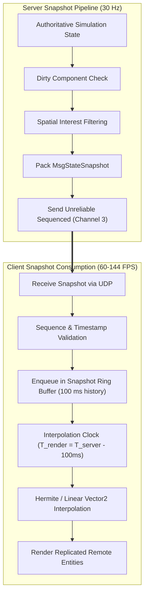

# WILDBOUND — STATE SYNCHRONIZATION SPECIFICATION
## Snapshots, Delta Compression, Remote Entity Interpolation, and Clocks

**Document ID:** `WB-NET-008`  
**Phase:** 35 — Multiplayer Architecture & Server Authority Design  
**Author:** Wildbound Engine Architecture Team  
**Date:** 2026-11-07  
**Status:** Approved / Authoritative  

---

### 1. State Synchronization Overview

In an authoritative Battle Royale, the server periodically generates a snapshot of the game state and broadcasts it to connected clients. State synchronization ensures that every client renders an accurate, smooth, and physically plausible representation of the shared fantasy island.

#### Core Challenges Addressed
1. **Network Jitter & Packet Loss**: Packets do not arrive at uniform intervals. Displaying raw received coordinates results in visual stuttering and rubber-banding.
2. **Bandwidth Limits**: 40+ players moving on a large island would overwhelm network links if full states were sent every tick.
3. **Temporal Offset**: The server runs at time $T_{\text{server}}$, while the client views remote players rendered in the recent past ($T_{\text{render}} = T_{\text{server}} - \Delta t_{\text{interp}}$).

---

### 2. Snapshot Architecture



---

### 3. Snapshot Data Layout

A state snapshot packet contains the server simulation tick, sequence number, and a compacted array of entity states:

```text
Field Name            | Data Type   | Size (Bytes) | Description
----------------------|-------------|--------------|---------------------------------------------
protocol_magic        | uint32      | 4            | 'WBND' (0x57424E44)
message_type          | uint8       | 1            | 0x05 (MsgStateSnapshot)
server_tick           | uint64      | 8            | Monotonically increasing server tick count
snapshot_sequence     | uint32      | 4            | Incremental snapshot ID
server_timestamp_ms   | uint64      | 8            | Server wall-clock time
acknowledged_input_seq| uint32      | 4            | Last client input processed for local player
entity_count          | uint16      | 2            | Number of entity updates in this snapshot
-- Repeated for entity_count entities:
  network_id          | uint32      | 4            | Entity identifier
  generation          | uint32      | 4            | Generational check against stale entities
  dirty_mask          | uint16      | 2            | Component bitmask defining present fields
  [conditional fields]| var         | 0 - 32       | Position, velocity, facing, health, etc.
```

---

### 4. Remote Entity Interpolation (Interpolation Buffer)

To guarantee silky-smooth 60+ FPS motion of other players and bots regardless of network packet jitter, the client never renders remote entities at their latest received packet position. Instead, it renders them slightly behind real-time using an **Interpolation Buffer**.

#### Mathematical Formulation
Let:
- $T_{\text{server}}$ be the current estimated server time.
- $\Delta t_{\text{interp}}$ be the configured interpolation delay (default: $100\text{ ms}$, equal to $3$ snapshot intervals at $30\text{ Hz}$).
- $T_{\text{render}} = T_{\text{server}} - \Delta t_{\text{interp}}$ be the client's current render time.

The client searches its snapshot buffer for two consecutive snapshots $S_1$ and $S_2$ such that:
$$T_{S_1} \le T_{\text{render}} \le T_{S_2}$$

The interpolation factor $\alpha$ is computed as:
$$\alpha = \frac{T_{\text{render}} - T_{S_1}}{T_{S_2} - T_{S_1}} \quad \in [0.0, 1.0]$$

The visual position $\mathbf{P}(T_{\text{render}})$ is calculated using linear interpolation (or Hermite spline when velocities $\mathbf{V}_1, \mathbf{V}_2$ are present):
$$\mathbf{P}(T_{\text{render}}) = (1 - \alpha)\mathbf{P}_{S_1} + \alpha \mathbf{P}_{S_2}$$

Facing angle $\theta$ is interpolated along the shortest angular arc:
$$\theta(T_{\text{render}}) = \theta_{S_1} + \alpha \cdot \text{atan2}\big(\sin(\theta_{S_2} - \theta_{S_1}), \cos(\theta_{S_2} - \theta_{S_1})\big)$$

---

### 5. Extrapolation & Packet Loss Handling

If network packets are lost or delayed such that $T_{\text{render}} > T_{\text{latest}}$:
1. **Dead Reckoning (Extrapolation)**: The client extrapolates position along the last known velocity vector:
   $$\mathbf{P}_{\text{extrap}} = \mathbf{P}_{\text{latest}} + \mathbf{V}_{\text{latest}} \cdot (T_{\text{render}} - T_{\text{latest}})$$
2. **Bounded Limit**: Extrapolation is capped at a maximum of $150\text{ ms}$ (approx. $4.5$ ticks).
3. **Decay & Freeze**: Beyond $150\text{ ms}$, velocity is smoothly decayed to zero to prevent entities from walking through walls or flying across the screen during severe lag spikes.
4. **No Extrapolation for Combat**: Extrapolation is strictly visual. The server never extrapolates health damage or melee hits.

