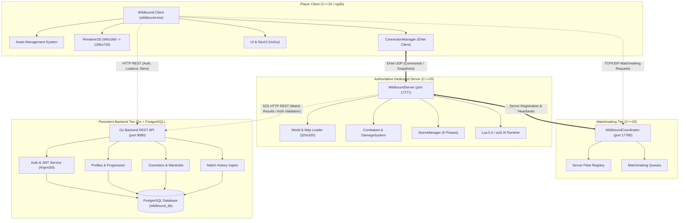

# WILDBOUND — PHASE 50A: ARCHITECTURE & SYSTEM DEPENDENCY MAP
**Document Reference:** `docs/phase50/phase50A_architecture_map.md`  
**Parent Document:** Phase 50A Initial Repository Audit  
**Execution Mode:** STRICT AUDIT-ONLY  
**Date:** 2026-11-08  

---

## 1. System Architecture Overview

Wildbound is organized as a distributed, authoritative multi-tier architecture combining low-latency UDP binary networking for gameplay simulation, high-level HTTP/JSON services for persistent state, and modular embedded runtimes (raylib, Lua 5.4, sol2) for client simulation.

---

## 2. End-to-End Data & Network Flows

### Flow 1: Authentication & Profile Bootstrapping
1. Client initiates HTTPS `POST /api/v1/auth/login` to Go Backend with credentials.
2. Backend queries PostgreSQL `users` table, verifies password hash using Argon2id.
3. Backend issues short-lived JWT Access Token ($15\text{ min}$) and cryptographically random Refresh Token ($7\text{ days}$).
4. Client requests `GET /api/v1/players/me/loadout` to fetch equipped cosmetics and progression level.
5. Client initializes local AMS using `AssetManager::LoadManifest()`.

### Flow 2: Matchmaking & Server Assignment
1. Client connects to `WildboundCoordinator` on port 17780.
2. Client submits ticket to Matchmaking Queue with selected Game Mode (`Solo`, `Duos`, or `Squads`).
3. Dedicated Servers (`WildboundServer`) launch, bind to port 17777, and register available capacity with Coordinator.
4. Coordinator forms match when queue threshold is satisfied and dispatches assignment token to both Client and Dedicated Server.

### Flow 3: Server-Authoritative Gameplay Loop (30 Hz Tick)
1. **Client Input Sampling (60 FPS):** `InputManager` samples movement and attack inputs, queues commands with sequence numbers.
2. **Packet Transmission:** Client sends `PACKET_TYPE_CLIENT_INPUT` over unsequenced unreliable ENet channel to dedicated server.
3. **Server Validation (30 Hz Fixed Step):**
   - `SecurityValidator` verifies movement delta against maximum velocity (anti-teleport clamp).
   - `SweptAABB` resolves collision against spatial collision grid.
   - `LuaManager` steps AI decision scripts (Goblin, Skeleton) within instruction count budget.
   - `CombatSystem` validates attack ranges, weapon cooldowns, and hitbox overlaps.
   - `StormManager` applies radiation damage to players outside current safe zone.
4. **State Broadcast:** Server encodes full/delta `PACKET_TYPE_SERVER_SNAPSHOT` and broadcasts to connected clients.
5. **Client Interpolation:** Client receives snapshots, buffers them, and smoothly interpolates entity positions over historical render time.

### Flow 4: Match Finalization & Result Persistence
1. Dedicated server detects victory condition (one remaining team/player).
2. `ResultsCalculator` compiles match telemetry: placement, kills, damage dealt, survival time, XP earned.
3. Dedicated server issues Server-to-Server authenticated `POST /api/v1/internal/matches` to Go Backend.
4. Go Backend persists record in `match_history` and `player_stats` within an ACID PostgreSQL transaction.
5. Dedicated server commands clients to disconnect; clients transition back to main menu lobby.

---

## 3. Subsystem Dependency & Coupling Matrix

| Subsystem | Upstream Dependencies | Downstream Dependents | Coupling Risk |
| :--- | :--- | :--- | :---: |
| **`core`** | Platform OS APIs | Almost all subsystems | Low (Well isolated) |
| **`resources` (AMS)** | `core`, nlohmann_json, raylib | `graphics`, `entities`, `ui`, `world` | Medium |
| **`graphics`** | raylib, `core`, `resources` | `ui`, `entities`, `world` | High (UI & entities tied to raylib types) |
| **`scripting`** | Lua 5.4, sol2, `core` | `ai`, `entities`, `server` | Low (Sandboxed) |
| **`network`** | ENet, `core` | `server`, `client`, `entities` | Medium |
| **`combat`** | `core`, `weapons`, `audio` | `entities`, `server`, `match` | Low |
| **`server`** | `network`, `world`, `combat`, `storm`, `scripting` | `coordinator`, `backend` | High (Central orchestrator) |
| **`backend`** | Go standard library, Chi, pgxpool | PostgreSQL DB | Low (Clean microservice boundary) |

