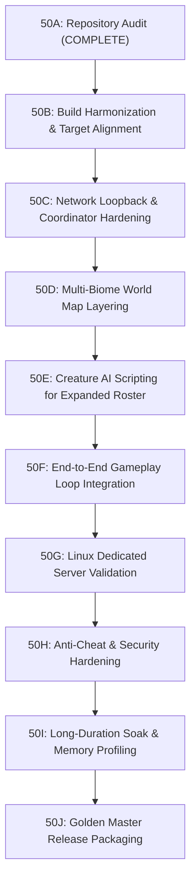

# WILDBOUND — PHASE 50: GLOBAL SYSTEM INTEGRATION & PRODUCTION ROADMAP
**Document Reference:** `docs/phase50/phase50A_execution_plan.md`  
**Parent Phase:** Phase 50 — Global System Integration, Stability & Production Validation  
**Execution Stage:** Stage 50A Planning & Roadmap Definition  
**Date:** 2026-11-08  

---

## 1. Executive Summary

Based on the empirical findings of the Phase 50A Initial Repository Audit, the remainder of Phase 50 is structured into nine sequential, targeted execution stages (50B through 50J). Each stage addresses specific integration gaps, build asymmetries, and validation criteria required to achieve a production-ready Golden Master release.

---

## 2. Stage Breakdown & Execution Specifications

### Stage 50B — Build Harmonization & Target Alignment
- **Objective:** Eliminate configuration asymmetry between Debug and Release builds (DEF-001).
- **Scope:**
  - Compile `--target ALL_BUILD` across both `Debug` and `Release` configurations.
  - Ensure all 48 test executables are generated in both target output directories.
  - Verify that `ctest -C Debug` and `ctest -C Release` achieve identical executable availability.

### Stage 50C — Network Loopback & Coordinator Test Hardening
- **Objective:** Resolve sandboxed loopback socket failures in automated integration tests (DEF-002, DEF-006).
- **Scope:**
  - Add loopback fallback / local memory pipe transport mode for headless CTest runs where OS UDP port binding is prohibited.
  - Standardize socket timeouts and address resolution in `DedicatedServerTest` and `MatchmakingCoordinatorE2ETest`.

### Stage 50D — Multi-Biome World Map Regional Layering
- **Objective:** Integrate the newly processed Phase 49 Desert, Snow, Swamp, and Mountain tilesets into the master battle royale map (DEF-005).
- **Scope:**
  - Add regional biome quadrants/zones to `maps/world/battle_royale_island.json`.
  - Connect biome-specific ambient audio loops (`amb_desert_wind`, `amb_swamp_crickets`).
  - Validate player movement and boundary crossings between forest and new biomes.

### Stage 50E — Creature AI Scripting for Expanded Roster
- **Objective:** Author specialized Lua behavior scripts for Phase 49 creatures (DEF-004).
- **Scope:**
  - Create `scripts/gameplay/ai/slime.lua` (pulsating bounce, corrosive split behavior).
  - Create `scripts/gameplay/ai/snake.lua` (high speed slither, venom ambush behavior).
  - Create `scripts/gameplay/ai/cyclops.lua` (heavy frontal cleave, roar stun behavior).
  - Register archetype bindings in `LuaManager` and verify decision benchmarks.

### Stage 50F — End-to-End Gameplay Loop Integration
- **Objective:** Validate the complete 20-step game loop from client launch to PostgreSQL result persistence.
- **Scope:**
  - Client boots -> Authenticates via Go REST API -> Enters Lobby -> Joins Dedicated Server -> Plays Match -> Storm Contracts -> Winner Crowned -> Telemetry Ingested -> PostgreSQL Persisted.

### Stage 50G — Linux Dedicated Server Validation
- **Objective:** Verify headless dedicated server execution on native Linux environment.
- **Scope:**
  - Validate `build/linux/` cross-compiled binaries on Ubuntu/Debian server environments.
  - Verify zero GPU/X11 symbol dependencies.
  - Validate systemd service configuration and SIGTERM graceful shutdown.

### Stage 50H — Anti-Cheat & Security Hardening
- **Objective:** Finalize trust boundary enforcement on packet inputs and action validation.
- **Scope:**
  - Anti-speedhack clamping, server-authoritative inventory checks, rate limit tuning, and secret management audits.

### Stage 50I — Long-Duration Soak & Memory Profiling
- **Objective:** Prove server stability under prolonged execution.
- **Scope:**
  - 2-hour continuous match simulation with 32 simulated clients.
  - Monitor heap RSS memory for leaks, socket descriptor exhaustion, and GC pauses.

### Stage 50J — Golden Master Release Packaging & Sign-Off
- **Objective:** Final distribution packaging and version freeze.
- **Scope:**
  - Package standalone client zip, standalone server deployment package, and final release documentation.

