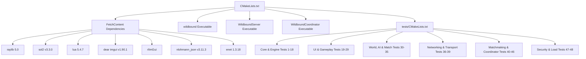

# Phase 50B: CMake Architecture Report

**Project:** Wildbound  
**Phase:** 50B — Build System Harmonization & Test Infrastructure Validation  
**Date:** 2026-11-08  
**Build System:** CMake 4.3.0  
**Generator:** Visual Studio 18 2026  
**Language Standard:** C++20 (`cxx_std_20`)  
**C Standard:** C99 (`CMAKE_C_STANDARD 99`)  

---

## 1. Top-Level CMake Architecture Overview

Wildbound's build architecture is organized into a modular, multi-target hierarchy configured across two primary CMake descriptor files:
1. `CMakeLists.txt` (Root Project Definition): Defines compiler options, FetchContent dependencies, runtime assets post-build deployment, and primary application targets (`wildbound`, `WildboundServer`, `WildboundCoordinator`).
2. `tests/CMakeLists.txt` (CTest Test Harness): Defines 47 distinct unit, component, subsystem, and integration test executables, along with 48 registered CTest definitions.



---

## 2. Dependency Management & FetchContent

All third-party libraries are acquired and configured via CMake's `FetchContent` module, guaranteeing hermetic, reproducible builds without requiring system-installed package managers:

| Dependency | Version / Tag | Commit Hash | Fetch Strategy | Configuration Flags |
|---|---|---|---|---|
| **raylib** | 5.0 | `master` | Git Clone | `BUILD_EXAMPLES=OFF`, `BUILD_GAMES=OFF`, `CUSTOMIZE_BUILD=ON` |
| **sol2** | 3.3.0 | `v3.3.0` | Git Clone | Header-only target (`sol2::sol2`) |
| **lua** | 5.4.7 | Source Archive | Tarball Download | Compiled as static library `lua_static` |
| **imgui** | 1.90.1-docking | `docking` | Git Clone | Compiled in-tree with Win32/OpenGL backends |
| **rlimgui** | main | Git Clone | Git Clone | Raylib-ImGui bridge |
| **nlohmann_json** | 3.11.3 | `v3.11.3` | Git Clone | Header-only target (`nlohmann_json::nlohmann_json`) |
| **enet** | 1.3.18 | `v1.3.18` | Git Clone | Compiled with `HAS_SOCKLEN_T`, `HAS_GETHOSTBYNAME_R` |

---

## 3. Main Executable Targets

### 3.1 `wildbound` (Game Client)
- **Sources**: `src/main.cpp` + `${WILDBOUND_SOURCES}` (complete engine, rendering, world, combat, customization, networking, HTTP client, security).
- **Include Directories**: `src/`, `sol2/include`, `lua/src`, `imgui/`, `rlimgui/`, `enet/include`.
- **Link Libraries**: `raylib`, `sol2`, `lua_static`, `imgui`, `rlimgui`, `nlohmann_json::nlohmann_json`, `enet`, `winhttp` (on Win32).
- **Compile Definitions**: `NOGDI`, `WIN32_LEAN_AND_MEAN`.
- **Post-Build Deployments**: Automatically mirrors `assets/`, `scripts/`, `config/`, `maps/`, and `data/` into `$<TARGET_FILE_DIR:wildbound>`.

### 3.2 `WildboundServer` (Headless Dedicated Server)
- **Sources**: `src/server/main_server.cpp`, `src/server/DedicatedServer.cpp`, `src/server/MatchResultsOutbox.cpp` + `${WILDBOUND_SOURCES}`.
- **Link Libraries**: `raylib`, `sol2`, `lua_static`, `imgui`, `rlimgui`, `nlohmann_json::nlohmann_json`, `enet`, `ws2_32`, `winmm`, `winhttp`.
- **Compile Definitions**: `NOGDI`, `WIN32_LEAN_AND_MEAN`, `NOUSER`.
- **Isolation Characteristic**: Does not initialize graphical windows or audio playback; links stub/headless subsystems during runtime execution.

### 3.3 `WildboundCoordinator` (Matchmaking & Session Coordinator)
- **Sources**: `src/coordinator/main_coordinator.cpp`, `src/coordinator/CoordinatorServer.cpp`, `src/coordinator/SessionRegistry.cpp`, `src/coordinator/LobbyRegistry.cpp`, `src/coordinator/ServerRegistry.cpp`, `src/coordinator/Matchmaker.cpp` + core networking sources.
- **Link Libraries**: `enet`, `nlohmann_json::nlohmann_json`, `ws2_32`, `winmm`.
- **Isolation Characteristic**: Completely independent of `raylib`, `sol2`, `lua`, or `imgui`.

---

## 4. Test Target Architecture & Macro Abstractions

In `tests/CMakeLists.txt`, test targets are constructed using structured source sets to avoid excessive duplication:
- `GAMEMODES_SOURCES`: All team and game-mode logic (`src/gamemodes/`).
- `MATCH_RESULTS_STORM_SOURCES`: Match state, spawner, elimination, results, and storm systems (`src/match/`, `src/results/`, `src/storm/`).
- `GAMEPLAY_INTEGRATION_SOURCES`: Core entity, physics, combat, audio, animation, and world dependencies.
- `BACKEND_HTTP_SOURCES` (*Introduced in Phase 50B*): `src/network/http/HttpClient.cpp` and `src/network/http/BackendClient.cpp`.

Every test executable is compiled with:
```cmake
target_compile_features(<target> PRIVATE cxx_std_20)
target_include_directories(<target> PRIVATE ${CMAKE_SOURCE_DIR}/src)
```
And registered with CTest using:
```cmake
add_test(NAME <TestName> COMMAND <target>)
set_tests_properties(<TestName> PROPERTIES WORKING_DIRECTORY "${CMAKE_SOURCE_DIR}")
```

Setting `WORKING_DIRECTORY` to `${CMAKE_SOURCE_DIR}` ensures that relative asset paths (`assets/`, `data/`, `maps/`, `config/`) resolve uniformly whether tests are invoked via Visual Studio IDE, manual terminal execution, or CTest runners.

