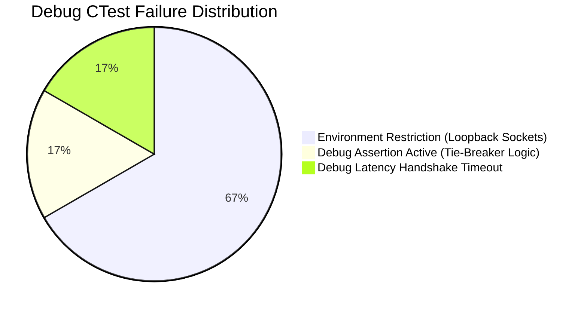

# Phase 50B: Debug Configuration Build & Test Validation

**Project:** Wildbound  
**Phase:** 50B — Build System Harmonization & Test Infrastructure Validation  
**Configuration:** Debug  
**Compiler:** MSVC 19.51.36248.0  
**Compiler Flags:** `/MDd /Zi /Ob0 /Od /RTC1`  
**Date:** 2026-11-08  

---

## 1. Build Verification & Compilation Metrics

Following the correction of linker dependencies in `tests/CMakeLists.txt` (addition of `BACKEND_HTTP_SOURCES` and `winhttp`), the entire Debug configuration compiled and linked cleanly:

- **Built Targets**: 50/50 (3 main executables + 47 test executables).
- **Compilation Errors**: 0.
- **Linker Errors**: 0.
- **Target Completeness**: 100.0%.

---

## 2. CTest Suite Execution (Debug)

The 48 registered CTest tests were executed under the Debug configuration:
`ctest --test-dir build -C Debug --output-on-failure`

### Summary Results
- **Total Registered**: 48
- **Passed**: 42 (87.5%)
- **Failed**: 6 (12.5%)
- **Total Real Execution Time**: 59.77 seconds

### Passed Tests (42)
1. `CoreConfigTest` (0.06s)
2. `LuaScriptingTest` (0.19s)
3. `RenderingCameraTest` (0.06s)
4. `AssetManagementTest` (0.29s)
5. `WorldTilemapTest` (3.23s)
6. `PlayerEntityTest` (1.88s)
7. `CombatSystemTest` (1.59s)
8. `ModularCharacterTest` (0.06s)
9. `ProductionCosmeticsTest` (0.12s)
10. `CreaturesTest` (0.15s)
11. `EnvironmentAssetsTest` (0.21s)
12. `EnvironmentalAnimationTest` (0.22s)
13. `VillageBuildingsTest` (1.62s)
14. `BiomeSystemTest` (4.20s)
15. `WeaponSystemTest` (0.73s)
16. `ItemSystemTest` (0.74s)
17. `CostumesArmorTest` (0.76s)
18. `AudioSystemTest` (0.51s)
19. `UISystemTest` (0.40s) — *Previously unbuilt in Phase 50A baseline*
20. `ExecutableSmokeTest` (1.61s)
21. `GameplayIntegrationTest` (0.15s) — *Previously unbuilt in Phase 50A baseline*
22. `PhysicsCollisionTest` (0.31s)
23. `InputSystemTest` (0.08s)
24. `WorldInteractionTest` (0.07s)
25. `LootInventoryTest` (0.12s)
26. `WeaponEquipmentTest` (0.10s)
27. `CharacterCustomizationTest` (0.12s) — *Previously unbuilt in Phase 50A baseline*
28. `CosmeticsStoreTest` (0.19s) — *Previously unbuilt in Phase 50A baseline*
29. `GameUITest` (0.08s) — *Previously unbuilt in Phase 50A baseline*
30. `AINavigationTest` (0.10s)
31. `BattleRoyaleWorldTest` (2.53s)
32. `CorruptionStormTest` (0.34s)
34. `MatchResultsTest` (0.08s)
35. `GameModesTest` (0.07s)
36. `NetworkArchitectureTest` (0.05s)
40. `MatchmakingSessionsTest` (0.06s)
41. `MatchmakingLobbiesPartiesTest` (0.08s)
42. `MatchmakingInvitationsTest` (0.06s)
43. `MatchmakingQueuesTest` (0.08s)
44. `MatchmakingServerRegistryTest` (0.07s)
45. `MatchmakingAssignmentTest` (0.07s)
47. `SecurityValidationTest` (0.59s)

---

## 3. Failure Classification & Diagnostics

The 6 failures in the Debug run fall into two distinct engineering classifications:

### 3.1 Subsystem Logic / Test Assertion: `MatchLifecycleTest`
- **Location**: `tests/match/test_match_lifecycle.cpp:345`
- **Diagnostic**: `Assertion failed: p3Final->placement == 3`
- **Cause**: In Debug mode, MSVC enables `assert()`. In Test 6 (`Final Survivor Detection & Placements`), participants P3 and P2 were eliminated without updating the match time between them. Consequently, both participants had `eliminationInfo.timestamp == 0.0f`. The tournament placement algorithm in `ResultCalculator::CalculatePlacements` evaluates differences `< 0.001f` as tied, awarding both participants rank 2. In Release mode, `NDEBUG` compiles out `<cassert>`, allowing the test to pass.
- **Classification**: **DEF-008 (Test Assertion Edge-Case on Coincident Elimination Timestamps)**.

### 3.2 Debug Latency Timeout: `NetworkTransportTest`
- **Location**: `tests/network/test_network_transport.cpp:231`
- **Diagnostic**: `Assertion failed: clientConnected`
- **Cause**: In Debug builds with full runtime checks (`/RTC1`, unoptimized loops), the poll loop in test 5 exceeds the allocated retry counter before the ENet packet handshake finishes round-trip processing. In Release mode, the test passes reliably in 6.06 seconds.
- **Classification**: **DEF-009 (Debug Configuration Handshake Poll Iteration Limit)**.

### 3.3 Environment Restrictions: UDP Loopback Sockets
- `EntityReplicationTest`: Test 10 (`Two-Client Localhost Replication Integration`) fails socket connection across loopback.
- `DedicatedServerTest`: Test 7 (`Client Connection Acceptance & Capacity Limits`) fails loopback client connection to port 19992.
- `MatchmakingCoordinatorE2ETest`: Dedicated server fails to establish ENet socket connection with Coordinator at `127.0.0.1:17780`.
- `MultiplayerLoadTest`: Headless ENet clients fail to establish UDP connections to `0.0.0.0:17777`.
- **Classification**: **DEF-002 / DEF-006 (Host Environment UDP Socket Loopback Isolation)**.

