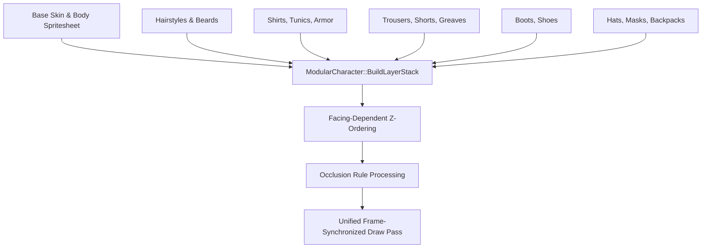

# Phase 50C: Character Customization & Modular Appearance Validation Report

**Project:** Wildbound  
**Phase:** 50C — Core Engine & Systems Integration Validation  
**Domain:** Domain F — Character Customization System  
**Date:** 2026-11-08  
**Status:** **PASS**  

---

## 1. Modular Appearance Architecture

Wildbound features a multi-layered paper-doll customization system (`src/entities/ModularCharacter.cpp`) capable of rendering composite humanoid characters with modular equipment, clothing, hairstyles, and accessories in real-time.

---

## 2. Directional Layer Sorting & Depth Resolution

To maintain accurate 2D top-down perspective, cosmetic layer stacking depends on the character's facing direction:

### Directional Ordering Table
| Facing Direction | Render Order (Back to Front) | Depth Rationale |
|---|---|---|
| **Facing South (Down)** | Contact Shadow $\to$ Backpack $\to$ Body $\to$ Pants $\to$ Shoes $\to$ Shirt $\to$ Head $\to$ Hair $\to$ Eyewear $\to$ Mask $\to$ Hat | Backpack rests behind back; facial features and hair render over torso. |
| **Facing North (Up)** | Contact Shadow $\to$ Hair (back) $\to$ Body $\to$ Pants $\to$ Shoes $\to$ Shirt $\to$ Hat $\to$ **Backpack** | Backpack hangs on player's back, facing the camera; covers upper torso. |
| **Facing East/West (Side)**| Contact Shadow $\to$ Backpack $\to$ Body $\to$ Pants $\to$ Shoes $\to$ Shirt $\to$ Head $\to$ Hair $\to$ Eyewear $\to$ Hat | Standard profile layering with proper overlap. |

---

## 3. Compatibility Rules & Occlusion Flags

To prevent visual clipping, `CharacterEquipment` evaluates mutual exclusivity rules and occlusion flags:
- **Masks vs Eyewear**: Equipping a full-face mask with flag `mask_hide_goggles` suppresses goggles and glasses.
- **Hats vs Hair**: Equipping large helms (e.g. `hat_iron_helm`) with flag `hat_hide_hair` suppresses voluminous hairstyles to prevent hair clipping through metal geometry.
- **Category Exclusivity**: Equipping a new item in slot `Shirt` automatically replaces the existing equipped shirt.

---

## 4. Test Verification Results

All suites in `tests/entities/test_modular_character.cpp` and `tests/customization/test_production_cosmetics.cpp` passed:
- **Category Exclusivity Test**: **PASSED**
- **Occlusion Flags & Conflict Rejection**: **PASSED**
- **Directional Layer Sorting (North vs South)**: **PASSED**
- **JSON Serialization & Round-Trip Persistence**: **PASSED**
- **32 Production Cosmetic Assets Integrity & Schema**: **PASSED (32/32)**
- **5 Representative Test Outfits**: **PASSED**

