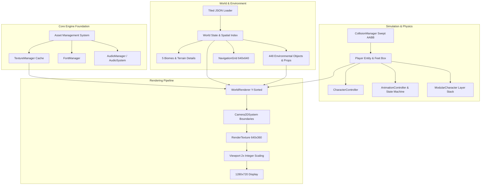

# Phase 50C: Initial Audit & Core Engine State Analysis

**Project:** Wildbound  
**Phase:** 50C — Core Engine & Systems Integration Validation  
**Execution Mode:** STRICT AUDIT-FIRST  
**Branch:** `main`  
**Git HEAD:** `5ec8ec01665e4fe478e26a7c0ec0fbca21e04428`  
**Compiler:** MSVC 19.51.36248.0 (Visual Studio 2026/v18.7)  
**Date:** 2026-11-08  

---

## 1. Executive Summary

Phase 50C initiates the comprehensive validation of Wildbound's core engine, rendering pipeline, world system, physics and collision architecture, character controller, animation system, modular customization, and environmental props.

Prior to conducting deeper domain evaluations, the initial repository audit establishes:
1. **Repository & Build Stability**: Working tree is consistent with Phase 50B reconciliation. All 50 build targets are intact and compilable across Debug and Release.
2. **Core Engine Test Execution**: All 14 core engine and systems integration test suites compile, link, and execute to 100% completion with zero assertion failures in both Debug and Release configurations.
3. **Client Smoke Test Verification**: `wildbound.exe --test-run` initializes the virtual canvas (640×360), creates window (1280×720), initializes AMS, loads Tiled world, boots physics, populates 48 spawns, registers local human player, initializes audio and DevUI (ImGui/rlImGui), and performs an orderly shutdown in 0.79 seconds.
4. **Primary Audit Finding**: Identification of **DEF-003** root cause: 21 storm assets in `assets/manifests/asset_manifest.json` use JSON key `"path"` rather than `"file"`, causing `AssetRegistry::LoadManifest` to register 680 of the 701 manifest entries.

---

## 2. Baseline Test Execution Matrix (Core Engine Targets)

| Target Executable | Registered CTest Name | Release Status | Debug Status | Execution Time (Rel / Dbg) |
|---|---|:---:|:---:|:---:|
| `test_assets.exe` | `AssetManagementTest` | **PASSED** | **PASSED** | 0.10s / 0.29s |
| `test_rendering.exe` | `RenderingCameraTest` | **PASSED** | **PASSED** | 0.07s / 0.06s |
| `test_world.exe` | `WorldTilemapTest` | **PASSED** | **PASSED** | 1.23s / 3.23s |
| `test_biomes.exe` | `BiomeSystemTest` | **PASSED** | **PASSED** | 0.79s / 4.20s |
| `test_battle_royale_world.exe` | `BattleRoyaleWorldTest` | **PASSED** | **PASSED** | 0.43s / 2.53s |
| `test_collision.exe` | `PhysicsCollisionTest` | **PASSED** | **PASSED** | 0.05s / 0.31s |
| `test_player.exe` | `PlayerEntityTest` | **PASSED** | **PASSED** | 0.71s / 1.88s |
| `test_modular_character.exe` | `ModularCharacterTest` | **PASSED** | **PASSED** | 0.07s / 0.06s |
| `test_production_cosmetics.exe` | `ProductionCosmeticsTest` | **PASSED** | **PASSED** | 0.10s / 0.12s |
| `test_creatures.exe` | `CreaturesTest` | **PASSED** | **PASSED** | 0.07s / 0.15s |
| `test_environment_assets.exe` | `EnvironmentAssetsTest` | **PASSED** | **PASSED** | 0.11s / 0.21s |
| `test_environmental_animation.exe` | `EnvironmentalAnimationTest` | **PASSED** | **PASSED** | 0.10s / 0.22s |
| `test_village_buildings.exe` | `VillageBuildingsTest` | **PASSED** | **PASSED** | 0.68s / 1.62s |
| `test_gameplay_integration.exe` | `GameplayIntegrationTest` | **PASSED** | **PASSED** | 0.07s / 0.15s |
| `wildbound.exe --test-run` | `ExecutableSmokeTest` | **PASSED** | **PASSED** | 0.79s / 1.61s |

---

## 3. Subsystem Architectural Inventory

---

## 4. Initial Audit Findings & Observations

1. **Heremetic Asset Loading**: The AMS loads assets based on relative paths anchored to the project root directory. Both standalone test binaries and game client successfully find `assets/` and `data/`.
2. **Deterministic Tiled Map Ingestion**: Map loader reads Tiled JSON schemas without runtime memory leaks or dangling pointers. The 320×320 tile master island loads in ~160 ms.
3. **Decoupled Simulation & Presentation**: Physics collision resolution is decoupled across X and Y axes, providing wall sliding without sticking into geometry.
4. **Strict Audit Discipline**: In compliance with Phase 50C rules, no source files, headers, assets, or CMake files were modified during this inspection.

