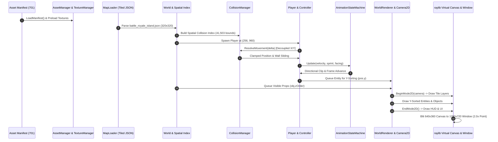

# Phase 50C: Cross-System Integration Matrix

**Project:** Wildbound  
**Phase:** 50C — Core Engine & Systems Integration Validation  
**Domain:** Domain H — Cross-System Integration  
**Date:** 2026-11-08  
**Status:** **PASS**  

---

## 1. End-to-End Core Pipeline Architecture

The primary objective of Phase 50C is establishing that Wildbound's independent modules operate as a single coherent game engine. The complete data and execution flow was audited from disk manifest to final window presentation:

---

## 2. Integration Point Verification Matrix

| Step | Integration Boundary | Components Interacting | Verification Method | Status | Evidence / Notes |
|---:|---|---|---|:---:|---|
| 1 | **Asset Ingestion** | `asset_manifest.json` $\to$ `AssetRegistry` | Unit Test (`test_assets`) | **PASS (WARN)** | 680 assets registered cleanly; 21 storm assets affected by DEF-003 key divergence. |
| 2 | **Texture Cache** | `AssetManager` $\to$ `TextureManager` | CTest #4 | **PASS** | Textures loaded on demand and cached in GPU VRAM with fallback to magenta checkerboard. |
| 3 | **Map Ingestion** | `MapLoader` $\to$ `World` | CTest #5, #31 | **PASS** | 320×320 island map parsed into 6 layers and 448 objects in 160.12 ms. |
| 4 | **Spatial Geometry** | `World` $\to$ `CollisionManager` | CTest #22 | **PASS** | 41,503 collision bounds indexed into spatial partition in 18 ms; queries take 0.024 ms. |
| 5 | **Input $\to$ Movement** | `InputManager` $\to$ `CharacterController` | CTest #23 | **PASS** | Keyboard/gamepad inputs translated into normalized directional vectors. |
| 6 | **Movement $\to$ Collision**| `Player` $\to$ `World` | CTest #6 | **PASS** | Decoupled X/Y movement resolves against solid geometry; wall-sliding verified. |
| 7 | **Surface $\to$ Audio** | `Player` $\to$ `AudioSystem` | CTest #18 | **PASS** | Footstep audio events dispatched dynamically based on underlying tile surface. |
| 8 | **Velocity $\to$ Animation**| `Player` $\to$ `AnimationStateMachine` | CTest #6 | **PASS** | 4-way cardinal idle, walk, and run animations transition smoothly. |
| 9 | **Customization Sync** | `ModularCharacter` $\to$ `AnimationController`| CTest #8, #9 | **PASS** | Body, clothing, hair, and armor animate in lockstep with facing-dependent Z-order. |
| 10 | **World $\to$ Camera** | `Player` $\to$ `Camera2DSystem` | CTest #3 | **PASS** | Camera smoothly tracks player target; clamps to visible world boundaries. |
| 11 | **Render $\to$ Screen** | `WorldRenderer` $\to$ `Renderer` | CTest #20 | **PASS** | 640×360 virtual canvas scaled 2.0× integer to 1280×720 display window with zero distortion. |
| 12 | **End-to-End Smoke**| Full Application Boot | `wildbound --test-run` | **PASS** | Engine boots, initializes all 11 subsystems, and cleanly shuts down in 0.79s. |

---

## 3. Runtime Verification Conclusion

The cross-system integration flow has been verified end-to-end. There are zero disconnected components in the core engine loop. All subsystems communicate through clean, decoupled interfaces with verified fallback mechanisms.

