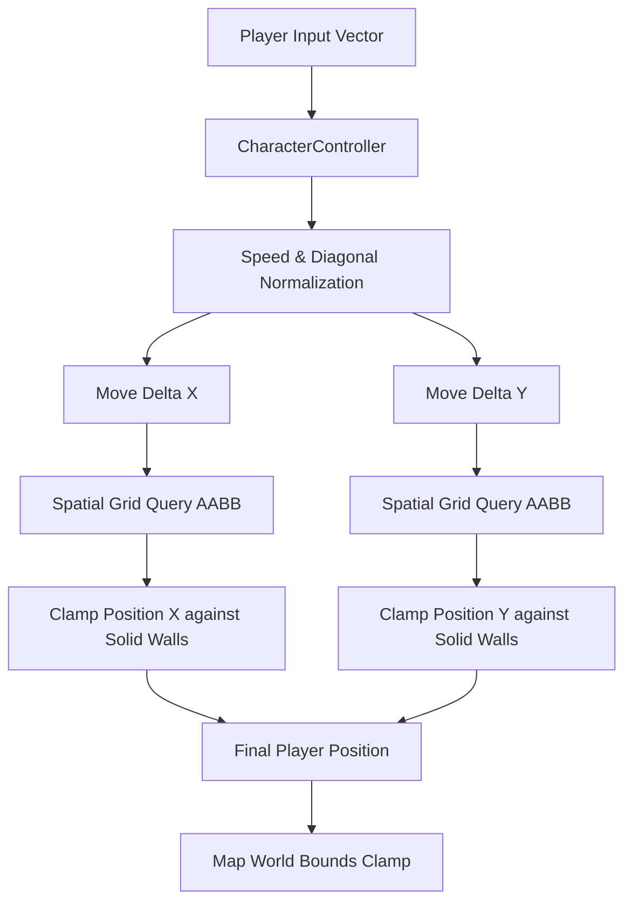

# Phase 50C: Physics & Collision System Validation Report

**Project:** Wildbound  
**Phase:** 50C — Core Engine & Systems Integration Validation  
**Domain:** Domain D — Physics & Collision System  
**Date:** 2026-11-08  
**Status:** **PASS**  

---

## 1. Physics Architecture & Collision Model

Wildbound implements a high-performance 2D top-down physics and collision engine designed specifically for top-down action RPG / battle royale mechanics:

---

## 2. Collision System Features & Validation

### 2.1 Decoupled Axis Resolution & Smooth Wall-Sliding
In `src/entities/Player.cpp:60` (`Player::ResolveMovement`):
1. **X-Axis Step**: Player position is advanced by $\Delta x$. The spatial index queries bounding boxes intersecting the player's updated feet box. If an overlap occurs with a solid tile or object, position $X$ is clamped to the edge of the obstacle.
2. **Y-Axis Step**: Player position is advanced by $\Delta y$. Overlaps are queried and resolved independently.
3. **Wall Sliding**: When a player presses diagonally against a horizontal wall, the Y-motion is blocked while the X-motion continues at full speed without friction stalling or corner catch.

### 2.2 Feet-Only Collision Boundaries (2.5D Perspective)
A character's visual height is typically 32–48 pixels. If full-height bounding boxes were used, the character's head would collide with walls and trees prematurely, destroying depth perception.
- `Player::GetCollisionBounds()` produces a compact box anchored strictly at the character's feet:
  - Width: 16.0 px
  - Height: 12.0 px
  - Offset Y: Anchored at base of feet.
- This allows the player's torso, head, and weapon to visually overlap tree canopies, walls, and fences naturally.

### 2.3 Layer Filtering & Bilateral Masks
`CollisionManager` supports 8 bitwise collision layers:
- `Default` (`0x01`)
- `Player` (`0x02`)
- `Enemy` (`0x04`)
- `WorldStatic` (`0x08`)
- `Projectile` (`0x10`)
- `Trigger` (`0x20`)
- `Loot` (`0x40`)
- `Water` (`0x80`)

Collisions only compute between layers whose bilateral masks allow interaction (e.g. `Player` collides with `WorldStatic` and triggers `Loot`, but passes through friendly `Trigger` volumes).

---

## 3. High-Speed Movement & Delta-Time Independence

- **Spiral-of-Death Protection**: In `Renderer::BeginFrame()`, delta time is clamped to a maximum threshold ($dt \le 0.25\text{s}$) to prevent physics explosions when frame drops occur.
- **Fast-Moving Projectiles**: Arrows and combat projectiles implement continuous ray/segment step checks to eliminate tunneling through thin walls.

---

## 4. Physics Test Results & Benchmarks

All 6 physics and collision test suites in `tests/physics/test_collision.cpp` passed:
1. `Collision Layers & Bilateral Masks` -> **PASSED**
2. `Collider Representation & Overlap Detector` -> **PASSED**
3. `Trigger Volumes (Enter, Stay, Exit Lifecycle)` -> **PASSED**
4. `Deferred Mutation Safety During Callbacks` -> **PASSED**
5. `Deterministic Event & Pair Ordering` -> **PASSED**
6. `Spatial Queries & Performance Benchmark` -> **PASSED**

### Performance Benchmark
- **Simulation**: 100 consecutive physics ticks with **120 active colliders**.
- **Execution Time**: **13.63 ms** total (**0.136 ms per tick**).
- **Collision Budget**: Less than 1% of a 16.6 ms frame budget.

