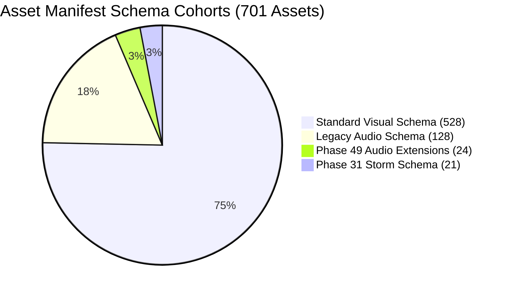
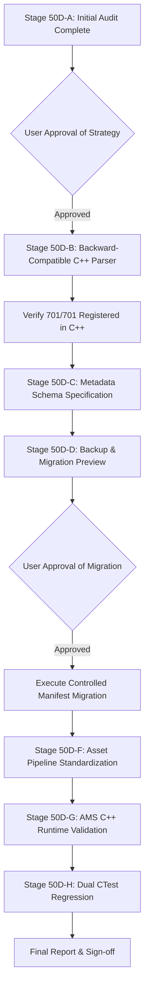

# Phase 50D: Initial Asset Infrastructure Audit & Migration Strategy

**Project:** Wildbound  
**Phase:** 50D — Asset Library Consolidation & Pipeline Standardization  
**Stage:** 50D-A (Initial Repository Audit)  
**Execution Mode:** STRICT AUDIT-FIRST / CONTROLLED IMPLEMENTATION  
**Date:** 2026-11-08  
**Branch:** `main` | **Commit:** `5ec8ec01665e4fe478e26a7c0ec0fbca21e04428`  
**Manifest File:** `assets/manifests/asset_manifest.json`  

---

## 1. Executive Summary

Wildbound's asset infrastructure was audited to establish the exact physical and logical status of all declared assets prior to implementing any parser fixes or metadata standardization.

### Key Audit Metrics:
- **Total Declared Manifest Entries**: **701**
- **Verified Files on Physical Disk**: **701** (100.0% file existence)
- **Missing Files on Physical Disk**: **0**
- **Duplicate Asset Identifiers**: **0** (100% unique IDs)
- **Currently Registered by AMS**: **680** (97.00%)
- **Currently Rejected by AMS**: **21** (3.00%)
- **Defects Under Remediation**:
  - **DEF-003**: 21 storm and corruption assets use schema key `"path"` instead of `"file"`, causing `AssetRegistry::RegisterAsset` to reject them due to an empty file string.
  - **DEF-007**: Metadata schema drift across project phases (camelCase vs snake_case fields, nested metadata sub-objects, missing attribution/license records).

---

## 2. Complete Inventory of Rejected Assets (DEF-003)

The following 21 assets physically exist in the `assets/` directory but fail registration during `AssetRegistry::LoadManifest` because they declare `"path"` instead of `"file"`:

| # | Asset ID | Type | Category | Physical File Path | Physical Status | Nested Metadata in Manifest |
|---:|---|:---:|:---:|---|:---:|---|
| 1 | `tex_storm_overlay` | texture | environment | `assets/environment/storm/storm_overlay.png` | **EXISTS** | `512×512, wrap: repeat` |
| 2 | `tex_corruption_cloud` | texture | environment | `assets/environment/storm/corruption_cloud.png` | **EXISTS** | `256×256, transparent: true` |
| 3 | `tex_storm_noise` | texture | environment | `assets/environment/storm/storm_noise.png` | **EXISTS** | `256×256, wrap: repeat` |
| 4 | `tex_storm_energy` | texture | environment | `assets/environment/storm/storm_energy.png` | **EXISTS** | `256×256, transparent: true` |
| 5 | `part_corruption_small` | texture | particles | `assets/environment/storm/part_corruption_small.png` | **EXISTS** | `16×16, transparent: true` |
| 6 | `part_corruption_medium` | texture | particles | `assets/environment/storm/part_corruption_medium.png` | **EXISTS** | `32×32, transparent: true` |
| 7 | `part_corruption_large` | texture | particles | `assets/environment/storm/part_corruption_large.png` | **EXISTS** | `64×64, transparent: true` |
| 8 | `part_energy_spark` | texture | particles | `assets/environment/storm/part_energy_spark.png` | **EXISTS** | `16×16, transparent: true` |
| 9 | `part_storm_debris` | texture | particles | `assets/environment/storm/part_storm_debris.png` | **EXISTS** | `32×32, transparent: true` |
| 10 | `tex_boundary_ring` | texture | environment | `assets/environment/storm/boundary_ring.png` | **EXISTS** | `256×256, transparent: true` |
| 11 | `tex_boundary_glow` | texture | environment | `assets/environment/storm/boundary_glow.png` | **EXISTS** | `256×256, transparent: true` |
| 12 | `icon_storm_approaching` | texture | ui | `assets/ui/icons/storm/icon_storm_approaching.png` | **EXISTS** | `48×48, transparent: true` |
| 13 | `icon_zone_shrinking` | texture | ui | `assets/ui/icons/storm/icon_zone_shrinking.png` | **EXISTS** | `48×48, transparent: true` |
| 14 | `icon_outside_zone` | texture | ui | `assets/ui/icons/storm/icon_outside_zone.png` | **EXISTS** | `48×48, transparent: true` |
| 15 | `icon_return_zone` | texture | ui | `assets/ui/icons/storm/icon_return_zone.png` | **EXISTS** | `48×48, transparent: true` |
| 16 | `icon_final_zone` | texture | ui | `assets/ui/icons/storm/icon_final_zone.png` | **EXISTS** | `48×48, transparent: true` |
| 17 | `icon_safe_status` | texture | ui | `assets/ui/icons/storm/icon_safe_status.png` | **EXISTS** | `48×48, transparent: true` |
| 18 | `sfx_storm_warning` | sound | audio | `assets/audio/sfx/events/sfx_storm_warning.wav` | **EXISTS** | `format: wav, bus: sfx` |
| 19 | `sfx_storm_shrink` | sound | audio | `assets/audio/sfx/events/sfx_storm_shrink.wav` | **EXISTS** | `format: wav, bus: sfx` |
| 20 | `sfx_storm_damage` | sound | audio | `assets/audio/sfx/combat/sfx_storm_damage.wav` | **EXISTS** | `format: wav, bus: combat` |
| 21 | `amb_storm_rumble` | sound | audio | `assets/audio/ambience/amb_storm_rumble.wav` | **EXISTS** | `format: wav, bus: environment, loop: true` |

---

## 3. Metadata Schema Drift & Variations (DEF-007)

An exhaustive key presence census across all 701 manifest entries revealed five distinct schema patterns:

### 3.1 Key Presence Census
| Key Name | Entries Present | Percentage | Variation Note |
|---|---:|---:|---|
| `id` | 701 | 100.0% | Universal unique string identifier |
| `type` | 701 | 100.0% | `texture`, `spritesheet`, `font`, `sound`, `music`, `data` |
| `category` | 701 | 100.0% | Subsystem category path (e.g. `characters/player`, `environment/trees`) |
| `file` | 680 | 97.0% | Canonical relative path to physical file |
| `path` | 21 | 3.0% | Divergent path key used in Phase 31 storm entries (DEF-003) |
| `source` | 680 | 97.0% | Origin studio, pack, or generator; missing in 21 storm entries |
| `author` | 680 | 97.0% | Creator name; missing in 21 storm entries |
| `license` | 680 | 97.0% | License string (`CC0 1.0 Universal`, `CC BY 3.0`); missing in 21 storm entries |
| `status` | 680 | 97.0% | `approved`, `license_review_required`; missing in 21 storm entries |
| `width` / `height` | 552 | 78.7% | Pixel dimensions; present in visual assets, omitted in audio |
| `commercial_use` (snake_case) | 528 | 75.3% | Standard visual assets |
| `commercialUse` (camelCase) | 152 | 21.7% | Audio assets use camelCase naming |
| `attribution_required` (snake) | 528 | 75.3% | Standard visual assets |
| `attributionRequired` (camel) | 152 | 21.7% | Audio assets use camelCase naming |
| `checksum` | 528 | 75.3% | SHA-256 / CRC hash; present in visual assets, omitted in audio/storm |
| `duration` | 128 | 18.3% | Playback length in seconds; present in early audio assets |
| `metadata` (nested object) | 21 | 3.0% | Storm assets nest dimensions, format, bus in sub-object |

---

## 4. Provenance & Licensing Register Audit

All 701 assets were cross-referenced against legal licensing documentation:

| Declared License | Asset Count | Percentage | Commercial Use | Attribution Required | Provenance / Sources |
|---|---:|---:|:---:|:---:|---|
| **CC0 1.0 Universal** | 652 | 93.01% | Permitted | No | Wildbound Development Studio (511), Wildbound Procedural Audio Generator (128), Superpowers Asset Packs (8), Kenney Roguelike Pack (4), Wildbound Audio Lab (1) |
| **CC BY 3.0** | 28 | 3.99% | Permitted | **Yes** | Game-icons.net (Lorc: 20 icons, Delapouite: 8 icons) |
| **Missing License (DEF-003)** | 21 | 3.00% | In-house | No | Phase 31 in-house storm textures & audio (Wildbound Development Studio / CC0) |
| **Total** | **701** | **100.0%** | **100% Permitted** | **28 Assets** | Zero unverified external licenses; zero non-commercial/paid licenses |

### Attribution Compliance:
All 28 CC BY 3.0 assets from Game-icons.net declare `commercial_use: true` and `attribution_required: true`, correctly attributing `author: "Lorc"` or `author: "Delapouite"`.

---

## 5. Proposed Implementation Strategy

To reach the target state (**701 verified $\to$ 701 registered $\to$ standardized schema**) without breaking existing references or modifying working code prematurely, the following sequenced plan is proposed:

### 5.1 Stage 50D-B: C++ Backward-Compatible Parser Fix (DEF-003)
In `src/resources/AssetMetadata.cpp` (`AssetMetadata::FromJson`):
1. Support both `"file"` and `"path"`:
   - Check if `"file"` exists and is non-empty.
   - If `"file"` is missing/empty, fall back to `"path"`.
   - If both `"file"` and `"path"` are present:
     - If they match, accept.
     - If they conflict, log a warning/error and prefer `"file"`.
   - Read nested `"metadata"` sub-objects for `"width"` and `"height"` if top-level fields are absent.
   - Accept both `commercial_use` and `commercialUse`.
   - Accept both `attribution_required` and `attributionRequired`.
2. This immediately unlocks all 21 storm assets in C++ **without touching the manifest file**.

### 5.2 Stage 50D-C & 50D-D: Controlled Manifest Standardization (DEF-007)
1. Formulate canonical schema:
   `id`, `type`, `file`, `category`, `source`, `author`, `license`, `commercial_use`, `attribution_required`, `checksum`, `width`, `height`, `duration`, `status`.
2. Create complete timestamped backup: `assets/manifests/asset_manifest.json.bak_phase50d`.
3. Provide a dry-run migration preview detailing the exact diff before overwriting `asset_manifest.json`.

---

## 6. Audit Verdict & Stop Condition

Stage 50D-A is complete. The exact root causes and schema distributions are documented. In accordance with Section 2 of Phase 50D instructions:

> **"STOP after the audit and present the findings before performing any mass migration."**

I will stop here and await your explicit approval of this audit and implementation strategy before modifying `AssetMetadata.cpp` or executing the manifest migration.

