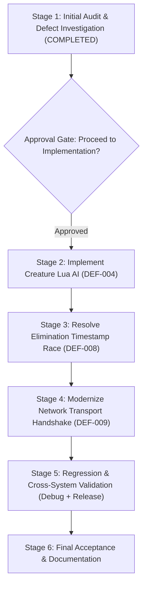

# Phase 50E — Implementation Plan
## Gameplay Systems, Combat & AI Verification

**Project:** Wildbound  
**Phase:** 50E  
**Stage:** Stage 1 — Implementation Planning (PENDING APPROVAL)  
**Date:** 2026-11-08  
**Scope:** Controlled Resolution of DEF-004, DEF-008, DEF-009

---

## 1. Non-Negotiable Architectural Boundaries

In accordance with Phase 50E execution rules:
1. **No Gameplay Expansion**: No new weapons, combat mechanics, enemy archetypes, biomes, or networking protocols.
2. **C++/Lua Separation**:
   - C++ maintains exclusive authority over simulation, movement execution, health, damage, and collision.
   - Lua scripts perform pure decision evaluation through the established `update_enemy(ctx)` interface.
   - Lua errors or timeouts must never crash the engine.
3. **Deterministic Match State**: Simultaneous eliminations must produce deterministic, strictly ordered or explicitly tied placements without state corruption.
4. **Network Protocol Preservation**: Handshake deadlines must respect protocol configuration without artificially increasing overall timeouts or weakening test assertions.

---

## 2. Step-by-Step Implementation Steps

### Step 1: DEF-004 — Specialized Creature Lua AI Archetypes

#### 1.1. Author Lua Behavior Scripts (`scripts/gameplay/ai/`)
1. **`scripts/gameplay/ai/slime.lua`**:
   - Archetype: Territorial marsh blob.
   - Behavior: Slow advance toward target, close-range `slime_slam` attack request, tethered retreat/disengagement at low HP ($\le 25\%$), spawn territory leash ($> 90$ units $\to$ `RETURN`).
   - Export: Bound to `wildbound.ai.slime_update` and returns table module.
2. **`scripts/gameplay/ai/snake.lua`**:
   - Archetype: Ambush viper.
   - Behavior: Ambush idle, rapid burst lunge `viper_strike` within strike radius ($34$ units), evasive retreat/repositioning at low HP ($\le 35\%$).
   - Export: Bound to `wildbound.ai.snake_update` (with alias `wildbound.ai.viper_update`).
3. **`scripts/gameplay/ai/cyclops.lua`**:
   - Archetype: Mountain brute boss.
   - Behavior: Long-range perception ($220$ units), heavy shockwave `cyclops_club` attack request, fearless relentless combat (`can_retreat = false`). Never flees.
   - Export: Bound to `wildbound.ai.cyclops_update`.

#### 1.2. Author Creature Archetype Configurations (`data/ai/creatures/`)
Create corresponding JSON definitions:
- `data/ai/creatures/slime.json`: Perception radii, preferred distance (20.0), retreat threshold (0.25).
- `data/ai/creatures/snake.json`: Ambush parameters, attack radius (34.0), retreat threshold (0.35).
- `data/ai/creatures/cyclops.json`: Heavy boss parameters, attack radius (48.0), `can_retreat: false`.

#### 1.3. Integrate with C++ `Game.cpp` Script Preloading
In `src/core/Game.cpp` (lines 225–230), add preloading for the 3 new scripts alongside `goblin.lua` and `skeleton.lua`.

---

### Step 2: DEF-008 — Deterministic Match Lifecycle Elimination Placements

#### 2.1. Test Fixture Correction (`tests/match/test_match_lifecycle.cpp`)
In `TestWinnerDetermination`:
Advance the match clock between the two sequential eliminations:
```cpp
    // Eliminate P3 at t = 10s
    mgr.ProcessElimination(3, EliminationCause::Combat, 1);
    assert(mgr.GetState() == MatchState::Active);
    assert(mgr.GetRegistry().GetAliveCount() == 2);

    // Advance match time by 10 seconds
    mgr.Update(10.0f);

    // Eliminate P2 at t = 20s
    mgr.ProcessElimination(2, EliminationCause::CorruptionStorm, 0);
```

#### 2.2. Production Tie-Breaking Invariant (`src/results/ResultCalculator.cpp`)
Enhance `ResultCalculator::CalculatePlacements` to support secondary deterministic tie-breaking:
```cpp
    // Sort descending by elimination timestamp, with deterministic tie-breaking
    std::sort(eliminatedList.begin(), eliminatedList.end(),
              [](const match::MatchParticipant* a, const match::MatchParticipant* b) {
                  float tA = a->eliminationInfo.timestamp;
                  float tB = b->eliminationInfo.timestamp;
                  if (std::abs(tA - tB) >= 0.001f) {
                      return tA > tB; // Survived longer = better rank
                  }
                  // Secondary: More kills = better rank
                  if (a->kills != b->kills) {
                      return a->kills > b->kills;
                  }
                  // Tertiary: More damage dealt = better rank
                  if (std::abs(a->damageDealt - b->damageDealt) >= 1.0f) {
                      return a->damageDealt > b->damageDealt;
                  }
                  // Quaternary: Lower participant ID = deterministic ordering
                  return a->participantId < b->participantId;
              });
```
Add an explicit test case in `tests/match/test_match_lifecycle.cpp` verifying simultaneous eliminations with tie-breaking.

---

### Step 3: DEF-009 — Debug Network Handshake Polling Modernization

#### 3.1. Replace Iteration Thresholds with Elapsed-Time Deadlines (`tests/network/test_network_transport.cpp`)
Modernize polling loops across `test_network_transport.cpp`:
```cpp
    // Localhost Client-Server Connection Lifecycle
    assert(client.Connect("127.0.0.1", port, 2000));

    auto deadline = std::chrono::steady_clock::now() + std::chrono::milliseconds(2000);
    while (std::chrono::steady_clock::now() < deadline && (!clientConnected || !serverConnected)) {
        client.Update(0.016f);
        server.Update(0.016f);
        std::this_thread::sleep_for(std::chrono::milliseconds(5));
    }

    assert(clientConnected);
    assert(serverConnected);
```
Apply this deadline pattern consistently across tests 5, 6, 7, 8, and 10 in `test_network_transport.cpp`.
Preserve all connection assertions, packet checks, and error handling.

---

## 3. Implementation Target Files

| Target File | Change Type | Purpose | Defect Addressed |
|---|:---:|---|:---:|
| `scripts/gameplay/ai/slime.lua` | **NEW** | Marsh Slime AI behavior evaluator | DEF-004 |
| `scripts/gameplay/ai/snake.lua` | **NEW** | Marsh Viper AI behavior evaluator | DEF-004 |
| `scripts/gameplay/ai/cyclops.lua` | **NEW** | Mountain Cyclops AI behavior evaluator | DEF-004 |
| `data/ai/creatures/slime.json` | **NEW** | Slime archetype AI config | DEF-004 |
| `data/ai/creatures/snake.json` | **NEW** | Viper archetype AI config | DEF-004 |
| `data/ai/creatures/cyclops.json` | **NEW** | Cyclops archetype AI config | DEF-004 |
| `src/core/Game.cpp` | **MODIFY** | Preload new creature AI scripts | DEF-004 |
| `tests/scripting/test_lua.cpp` | **MODIFY** | Add Slime, Snake, Cyclops unit tests | DEF-004 |
| `src/results/ResultCalculator.cpp` | **MODIFY** | Add secondary deterministic tie-breaking | DEF-008 |
| `tests/match/test_match_lifecycle.cpp` | **MODIFY** | Advance clock in Test 6; add simultaneous test | DEF-008 |
| `tests/network/test_network_transport.cpp` | **MODIFY** | Modernize polling loops to steady_clock deadlines | DEF-009 |

---

## 4. Execution Gating Structure



**STOP CONDITION**: No changes will be executed until explicit user authorization is received.

