# WILDBOUND — PHASE 50E STAGE 5
# SYSTEM INTEGRATION DEPENDENCY MAP

**Parent Phase:** Phase 50 — Global System Integration, Stability & Production Validation  
**Document Purpose:** Complete architectural dependency graph, coupling analysis, and boundary definition across all 14 integration domains.

---

## 1. High-Level Subsystem Architecture Graph

```mermaid
graph TD
    subgraph Client ["Client Executable (wildbound.exe)"]
        Game["Game (Core Engine Loop)"]
        Renderer["Renderer (raylib)"]
        AMS["AssetManager (AMS)"]
        World["World (Tiled Maps)"]
        Physics["CollisionManager"]
        Player["Player & Entities"]
        Combat["CombatSystem"]
        Lua["LuaManager (sol2)"]
        Inventory["Inventory & Items"]
        Storm["StormManager"]
        Match["MatchManager"]
        UI["UIManager (HUD / Menus)"]
        DevUI["DevUI (ImGui)"]
    end

    subgraph DedicatedServerHost ["Dedicated Server (WildboundServer.exe)"]
        DedicatedServer["DedicatedServer (Headless Loop)"]
        ServerNet["ENetServer"]
        Replication["ReplicationManager"]
        ServerWorld["World (Headless)"]
        ServerCombat["CombatSystem (Authoritative)"]
        ServerAI["AIManager (Lua AI)"]
        Outbox["MatchResultsOutbox"]
        HttpClient["HttpClient (C++ WinHTTP)"]
    end

    subgraph Matchmaking ["Matchmaking Coordinator (CoordinatorServer)"]
        CoordServer["CoordinatorServer (ENet)"]
        Sessions["SessionManager"]
        Parties["Party & Lobby Manager"]
        ServerRegistry["DedicatedServerRegistry"]
        MatchAssign["MatchAssignmentManager"]
    end

    subgraph BackendServices ["Go Backend & PostgreSQL"]
        GoAPI["Go REST API (Chi Router)"]
        AuthSvc["Auth & Token Service"]
        MatchSvc["Match Results Service"]
        CosmeticSvc["Cosmetics & Loadouts"]
        Postgres[(PostgreSQL Database)]
    end

    %% Client Internal Wiring
    Game --> Renderer
    Game --> AMS
    Game --> World
    Game --> Physics
    Game --> Player
    Game --> Combat
    Game --> Lua
    Game --> Inventory
    Game --> Storm
    Game --> Match
    Game --> UI
    Game --> DevUI

    %% Dedicated Server Internal Wiring
    DedicatedServer --> ServerNet
    DedicatedServer --> Replication
    DedicatedServer --> ServerWorld
    DedicatedServer --> ServerCombat
    DedicatedServer --> ServerAI
    DedicatedServer --> Outbox
    Outbox --> HttpClient

    %% Inter-Subsystem Network Wiring
    DedicatedServer -.->|"ENet Registration & Heartbeats"| CoordServer
    HttpClient -.->|"Async HTTP POST Outbox Recovery"| MatchSvc
    GoAPI --> Postgres
    GoAPI --> AuthSvc
    GoAPI --> MatchSvc
    GoAPI --> CosmeticSvc

    %% Unconnected / Isolated Paths
    Game -.->|"MISSING INTEGRATION"| DedicatedServer
    Game -.->|"MISSING INTEGRATION"| CoordServer
    Game -.->|"MISSING INTEGRATION"| GoAPI
```

---

## 2. Detailed Subsystem Coupling & Interface Analysis

### Group A: Local Core & Simulation (Coupling: Tight, Synchronous)
1. **`Game` → `Renderer` & `AssetManager`:**
   - Interface: Direct C++ unique pointers.
   - Lifecycle: `Renderer::Initialize(config)` creates raylib window and virtual canvas (640×360). `AssetManager::Initialize("assets")` parses `asset_manifest.json` and loads textures with point filtering.
   - Status: **Integrated & Verified.**

2. **`Game` → `World` → `CollisionManager`:**
   - Interface: Spatial grid indexing. `World::PopulateCollisionManager()` extracts 41,503 collision boxes from the map into spatial buckets.
   - Lifecycle: Static world geometry indexed once upon map load. Moving entities (Player, Enemies) update their dynamic AABBs per tick.
   - Status: **Integrated & Verified.**

3. **`Player` → `Physics` → `World`:**
   - Interface: Substepped axis-decoupled resolution (`MoveAndSlide`).
   - Coupling: Player samples `World::GetCollisionBoxes(bounds)` for horizontal axis, resolves position, then samples for vertical axis.
   - Status: **Integrated & Verified.**

4. **`CombatSystem` → `HealthComponent` → `MatchManager`:**
   - Interface: Observer events via `CombatEvents::SubscribeDeath()`.
   - Coupling: When lethal damage is dealt by an attack or storm, `HealthComponent` invokes death callback, firing `DeathEvent` into `MatchManager::HandleCombatDeath()`, updating elimination counts and placement calculations.
   - Status: **Integrated & Verified.**

5. **`EnemySpawner` → `AIManager` → `LuaManager`:**
   - Interface: sol2 C++/Lua state bindings.
   - Coupling: C++ executes `update_enemy(ctx)` every AI tick. Lua inspects state and returns movement direction and attack requests (`slime_slam`, `viper_strike`, `cyclops_club`). C++ authoritatively validates and executes the actions.
   - Status: **Integrated & Verified.**

---

### Group B: Headless Server & Network Authority (Coupling: Medium, Asynchronous/Packet-Based)
1. **`DedicatedServer` → `ENetServer` & `ReplicationManager`:**
   - Interface: ENet reliable/unreliable UDP channels on port 17777.
   - Coupling: DedicatedServer polls `ENetServer::Update(0.0f)`. Packets are validated by `PacketValidator`. `ReplicationManager` generates delta snapshots sent to connected clients.
   - Status: **Integrated & Verified.**

2. **`DedicatedServer` → `MatchResultsOutbox` → `HttpClient`:**
   - Interface: Durable disk queue (`user_data/outbox/`) + thread-reaped worker pool.
   - Coupling: When a match terminates on the dedicated server, results are serialized to JSON and stored on disk. `HttpClient` launches owned joinable threads to deliver payloads to the backend API.
   - Status: **Integrated & Verified.**

3. **`DedicatedServer` → `CoordinatorServer`:**
   - Interface: ENet client connection on port 18888.
   - Coupling: DedicatedServer registers itself with Coordinator using `ServerRegisterRequest` and emits periodic `ServerHeartbeat` packets.
   - Status: **Integrated & Verified.**

---

### Group C: Web Services, Identity & Persistence (Coupling: Loose, REST / PostgreSQL)
1. **`Go Backend (cmd/api)` → `PostgreSQL`:**
   - Interface: SQL migrations + `pgxpool` connection pool over TCP port 5432.
   - Coupling: REST handlers interact with repository layer (`internal/repository`).
   - Status: **Partially Implemented; Integration Blocked by offline DB daemon.**

2. **`MatchResultsOutbox` → `Go Backend (/api/v1/internal/matches/results)`:**
   - Interface: HTTP POST with `X-Server-Token` authentication header.
   - Coupling: Outbox deserializes response. If HTTP 200/201, outbox deletes disk file; otherwise, sets exponential backoff retry timer.
   - Status: **C++ Outbox logic fully implemented; Live end-to-end blocked by offline backend.**

---

## 3. Disconnected & Isolated Integration Boundaries

The following architectural interfaces currently lack integration:

| Origin Component | Target Component | Intended Purpose | Missing Bridge |
| :--- | :--- | :--- | :--- |
| `src/core/Game.cpp` | `src/network/NetworkManager.cpp` | Connect client to dedicated game server | Client network connect loop in `Game.cpp` |
| `src/ui/UIManager.cpp` | `src/ui/menus/MultiplayerMenu.cpp` | Surface multiplayer lobby in UI | Screen transition enum and update wiring |
| `src/ui/menus/MultiplayerMenu.cpp` | `src/coordinator/CoordinatorServer.cpp` | Join matchmaking queue from UI | Client-side ENet coordinator connection |
| `src/ui/UIManager.cpp` | `src/ui/menus/AuthMenu.cpp` | Surface login/registration screen in UI | Screen transition enum and update wiring |
| `src/core/Game.cpp` | `src/network/http/BackendClient.cpp` | Authenticate player session with backend | `BackendClient` instantiation in `Game.cpp` |
| `src/server/MatchResultsOutbox.cpp` | `backend/cmd/api` | Deliver match results to database | Running PostgreSQL and live Go API daemon |

---

## 4. Architectural Cohesion Matrix

| Subsystem Pair | Communication Medium | Thread Boundary | Safety Mechanism | Current Operational State |
| :--- | :--- | :--- | :--- | :--- |
| Game ↔ Renderer | In-memory API | Single-threaded | Direct calls | **OPERATIONAL** |
| Game ↔ Physics | In-memory API | Single-threaded | Spatial hashing | **OPERATIONAL** |
| Game ↔ Lua AI | sol2 C-call | Single-threaded | Protected calls | **OPERATIONAL** |
| DedicatedServer ↔ ENet | Socket I/O | Single-threaded | Non-blocking poll | **OPERATIONAL** |
| DedicatedServer ↔ Outbox | File I/O | Multi-threaded | File locks / RAII | **OPERATIONAL** |
| Outbox ↔ HttpClient | Thread pool | Multi-threaded | Owned joinable tasks | **OPERATIONAL** |
| DedicatedServer ↔ Coordinator | ENet Socket | Single-threaded | Packet serialization | **OPERATIONAL (In Tests)** |
| Coordinator ↔ Client | ENet Socket | Single-threaded | Protocol validation | **ISOLATED (In Tests Only)** |
| Client ↔ DedicatedServer | ENet Socket | Single-threaded | Snapshot replication | **ISOLATED (In Tests Only)** |
| HttpClient ↔ Go Backend | HTTP / TCP | Multi-threaded | Network timeouts | **BLOCKED (Offline DB)** |
| Go Backend ↔ PostgreSQL | pgxpool TCP | Multi-threaded | Connection pooling | **BLOCKED (Offline DB)** |

