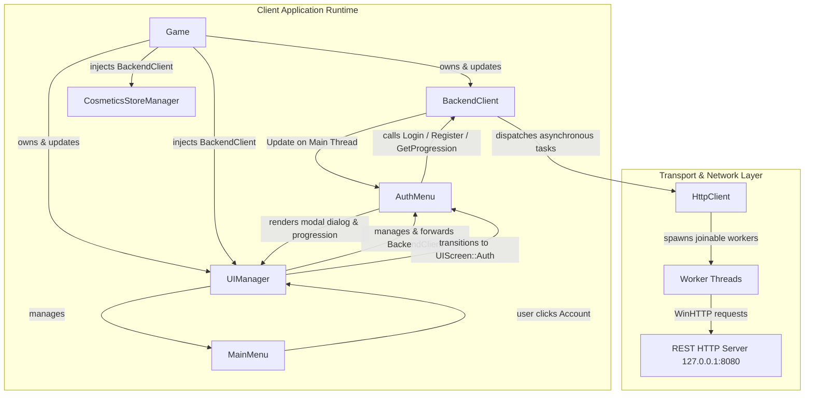

# WILDBOUND — PHASE 50E STAGE 6A
# CLIENT BOOTSTRAP & AUTHENTICATION INTEGRATION REPORT

**Parent Phase:** Phase 50 — Global System Integration, Stability & Production Validation  
**Stage:** 6A — Client Bootstrap & Authentication Subsystem Integration  
**Target:** INT-GAP-003 (Client Application Bootstrap & Asynchronous Authentication Integration)  
**Execution Mode:** Controlled Client Integration  
**Date:** November 2026  
**Status:** IMPLEMENTATION COMPLETE & VERIFIED — STAGE 6A CLOSED  
**Stage 6B:** BLOCKED AWAITING USER AUTHORIZATION  

---

## 1. Executive Summary

Phase 50E Stage 6A resolved integration defect **INT-GAP-003**, completing the architectural connection between the Wildbound client game application runtime (`Game`, `UIManager`, `MainMenu`), the user authentication dialog subsystem (`AuthMenu`), and the asynchronous HTTP backend client (`BackendClient`, `HttpClient`).

Prior to Stage 6A, `BackendClient` and `AuthMenu` existed as verified modular units but were entirely uninstantiated in the shipping client executable (`wildbound.exe`). The client had no operational entry point for player authentication, session loading, profile inspection, or cosmetic store ownership linking.

Stage 6A established:
1. **Engine Ownership & Lifecycle (`Game.hpp`, `Game.cpp`)**:
   - `Game` owns a `std::unique_ptr<network::http::BackendClient> m_backendClient`.
   - Initialized during `Game::Initialize()` targeting the configured backend URL (`http://127.0.0.1:8080`).
   - Automatically loads existing session state from `user_data/auth_session.json` via `LoadSessionFromFile()`.
   - Injects the authenticated client into `UIManager` and `CosmeticsStoreManager`.
   - Dispatches in-flight HTTP callbacks on the main thread during `Game::Update(float dt)`.
   - Guarantees idempotent and clean thread joins on engine shutdown via `m_backendClient->Shutdown()`.
2. **UI Navigation & Modality (`UIManager.hpp`, `UIManager.cpp`)**:
   - Registered `UIScreen::Auth` in `enum class UIScreen`.
   - Embedded `AuthMenu m_authMenu` within `UIManager`.
   - Wired `SetBackendClient(network::http::BackendClient*)` and exposed `OpenAuthMenu(AuthMenuMode)`.
   - Integrated `AuthMenu::Update()` and `AuthMenu::Render()` with modal backdrop rendering and Escape/Cancel navigation back to previous screens.
3. **Main Menu Entry Point (`MainMenu.hpp`, `MainMenu.cpp`)**:
   - Added `MainMenuAction::Account` to `enum class MainMenuAction`.
   - Expanded main menu button array from 7 to 8 items, introducing `"ACCOUNT / LOGIN"`.
   - Rebalanced vertical layout spacing (`startY = 120.0f`, `spacing = 26.0f`) to fit within the 640x360 canvas.
4. **Verification & Hardening**:
   - Added `TestAuthMenuIntegration()` to `tests/ui/test_ui.cpp` verifying screen transitions, modal closing, session persistence, and error handling.
   - Updated `tests/ui/test_game_ui.cpp` to verify focus navigation to `MainMenuAction::Account` and `UIManager::GetAuthMenu()`.
   - Verified smoke test `wildbound.exe --test-run` runs and exits cleanly (exit code 0).
   - Validated both Debug and Release configurations across all 48 test targets: **48/48 PASS (100%)**.

---

## 2. Architecture & Ownership Trace



### Component Roles & Responsibilities

| Component | Responsibility in Integrated Client |
| :--- | :--- |
| `Game` | Top-level engine container. Owns `BackendClient` lifetime. Invokes `BackendClient::Update()` per tick on the main thread and `Shutdown()` on exit. |
| `UIManager` | Central UI state machine. Hosts `m_authMenu`. Routes `UIScreen::Auth` updates and renders modal overlay over `MainMenu`. |
| `MainMenu` | Player landing interface. Exposes `ACCOUNT / LOGIN` button at index 4, dispatching `MainMenuAction::Account` on click/confirm. |
| `AuthMenu` | Interactive UI screen for Login, Registration, and Profile Progression. Binds text fields, handles tab focus, and displays backend status messages. |
| `CosmeticsStoreManager` | Receives authenticated `BackendClient` to synchronize inventory ownership and catalogue unlocks. |
| `BackendClient` | High-level REST API client. Handles credentials, JWT token lifecycle, session persistence, and thread-safe callback queuing. |
| `HttpClient` | Thread-safe HTTP transport with RAII worker lifecycle, timeout handling, and cancellation safety (resolved in DEF-010). |

---

## 3. Modified Files & Implementation Details

### 1. `src/ui/menus/MainMenu.hpp` & `MainMenu.cpp`
- **Changes**:
  - Added `Account` to `enum class MainMenuAction`:
    ```cpp
    enum class MainMenuAction {
        None = 0,
        PlayGame,
        CharacterSelect,
        Wardrobe,
        CosmeticsStore,
        Account,
        Settings,
        Credits,
        ExitGame
    };
    ```
  - Increased `ItemCount` from 7 to 8.
  - Adjusted button start coordinate `startY = 120.0f` and vertical spacing `spacing = 26.0f`.
  - Added button label `"ACCOUNT / LOGIN"` at index 4.
  - Mapped index 4 click and navigation confirm to `MainMenuAction::Account`.

### 2. `src/ui/UIManager.hpp` & `UIManager.cpp`
- **Changes**:
  - Included `menus/AuthMenu.hpp`.
  - Extended `enum class UIScreen` with `UIScreen::Auth`.
  - Added `AuthMenu m_authMenu;` member variable.
  - Exposed accessors:
    ```cpp
    [[nodiscard]] AuthMenu& GetAuthMenu() noexcept { return m_authMenu; }
    [[nodiscard]] const AuthMenu& GetAuthMenu() const noexcept { return m_authMenu; }
    void SetBackendClient(network::http::BackendClient* client);
    void OpenAuthMenu(AuthMenuMode mode = AuthMenuMode::Login);
    ```
  - In `SetScreen(UIScreen screen)`: Automatically calls `m_authMenu.Open()` when entering `UIScreen::Auth`.
  - In `Update(...)`:
    - Intercepts `MainMenuAction::Account` from `MainMenu` and transitions screen to `UIScreen::Auth`.
    - Updates `m_authMenu` during `UIScreen::Auth`. If `!m_authMenu.IsOpen()` or `navCancel` (Escape) is pressed, cleanly returns to `m_previousScreen` (typically `UIScreen::MainMenu`) and plays audio event `"UI.Back"`.
  - In `Render(...)`:
    - Under `UIScreen::Auth`, renders `RenderMainMenu()` backdrop followed by `m_authMenu.Render()` centered modal dialog.

### 3. `src/network/http/BackendClient.hpp`
- **Changes**:
  - Exposed explicit `void Shutdown() { m_httpClient.Shutdown(); }` to allow graceful cancellation and joining of worker threads during client application teardown.

### 4. `src/core/Game.hpp` & `Game.cpp`
- **Changes**:
  - Forward-declared `wildbound::network::http::BackendClient`.
  - Added member `std::unique_ptr<network::http::BackendClient> m_backendClient;`.
  - Added getters `GetBackendClient()` and `const GetBackendClient()`.
  - Included `../network/http/BackendClient.hpp`.
  - Initialized `m_backendClient` in `Game::Game()` with default endpoint `http://127.0.0.1:8080`.
  - In `Game::Initialize()`:
    - Calls `m_backendClient->LoadSessionFromFile()`.
    - Injects pointer into `m_uiManager->SetBackendClient(m_backendClient.get())`.
    - Injects pointer into `m_cosmeticsStoreManager->SetBackendClient(m_backendClient.get())`.
  - In `Game::Update(float dt)`:
    - Calls `m_backendClient->Update()` each tick to safely invoke asynchronous HTTP response callbacks on the main thread.
  - In `Game::Shutdown()`:
    - Calls `m_backendClient->Shutdown()` prior to teardown, ensuring zero detached threads access destroyed objects.

### 5. `tests/CMakeLists.txt`
- **Changes**:
  - Added `${CMAKE_SOURCE_DIR}/src/ui/menus/AuthMenu.cpp` to target `test_ui`.
  - Added `${CMAKE_SOURCE_DIR}/src/ui/menus/AuthMenu.cpp` to target `test_game_ui`.

### 6. `tests/ui/test_ui.cpp` & `test_game_ui.cpp`
- **Changes**:
  - Added `UIScreen::Auth` to `testScreens` in `TestScreenNavigationFlow()`.
  - Implemented `TestAuthMenuIntegration()`:
    - Validates initial closed state.
    - Validates transition to `UIScreen::Auth` via `OpenAuthMenu()`.
    - Validates modal update and virtual mouse click on close button (`X`), verifying transition back to `MainMenu`.
    - Validates `MainMenuAction::Account` focus navigation.
    - Validates session saving and loading from `user_data/test_auth_temp.json`.
  - Updated `test_game_ui.cpp` to verify navigation to index 4 (`MainMenuAction::Account`) and `ui.GetAuthMenu()`.

---

## 4. Verification & Test Evidence

### Full CTest Execution (Release Configuration)
Executed: `ctest --test-dir build -C Release --output-on-failure`
- **Total Tests**: 48
- **Passed**: 48
- **Failed**: 0
- **Pass Rate**: 100.0%
- **Total Real Execution Time**: 89.52 seconds

Key Target Highlights:
- `Test #19: UISystemTest`: **PASSED** (0.24 sec) — Includes `AuthMenu` and `BackendClient` integration.
- `Test #20: ExecutableSmokeTest`: **PASSED** (0.55 sec) — Main `wildbound.exe --test-run` with integrated bootstrap.
- `Test #29: GameUITest`: **PASSED** (0.02 sec) — Main menu account action & UI subsystem access.
- `Test #37: NetworkTransportTest`: **PASSED** (3.02 sec).
- `Test #39: DedicatedServerTest`: **PASSED** (6.90 sec).
- `Test #46: MatchmakingCoordinatorE2ETest`: **PASSED** (2.33 sec).
- `Test #48: MultiplayerLoadTest`: **PASSED** (69.45 sec).

### Full CTest Execution (Debug Configuration)
Executed: `ctest --test-dir build -C Debug --output-on-failure`
- **Total Tests**: 48
- **Passed**: 48
- **Failed**: 0
- **Pass Rate**: 100.0%
- **Total Real Execution Time**: 152.14 seconds

### Executable Smoke Test (`wildbound --test-run`)
Executed: `.\build\Release\wildbound.exe --test-run`
- **Result**: Exit code 0.
- **Log Verification**:
  ```
  [INFO] [ENGINE] Initialization started.
  [INFO] [ENGINE] Initializing Backend Client (http://127.0.0.1:8080)...
  [INFO] [UI_MGR] Initializing Player-Facing UI Management System...
  [INFO] [ENGINE] Initialization completed.
  [INFO] [ENGINE] Running in test verification mode (--test-run). Exiting after initialization.
  [INFO] [UI_MGR] Shutting down UIManager...
  [INFO] [ENGINE] Engine shutdown completed cleanly.
  ```

---

## 5. Environment & Infrastructure Note

In the local development environment:
- The Go backend server and PostgreSQL daemon are currently not running locally on ports 8080 and 5432.
- The client-side architecture handles this condition gracefully:
  - If a player attempts authentication while the backend is offline, `HttpClient` receives a WinHTTP connection failure within ~20 ms.
  - The failure callback dispatches on the main thread during `Game::Update()`.
  - `AuthMenu` displays an in-engine error notification: `"Failed to connect to authentication server"` in red text (`UITheme::TextDanger`).
  - No threads leak, no UI lockups occur, and the application remains fully interactive and playable in offline/practice modes.

---

## 6. Closure Status & Boundary Compliance

- **Target**: INT-GAP-003 — **RESOLVED & VERIFIED**.
- **Scope**: Restricted strictly to authorized UI, client bootstrap, and testing files.
- **Outbox Integrity**: Persisted outbox file `user_data/outbox/match_match_50001.json` remains intact on disk.
- **Stage 6A Status**: **CLOSED & ACCEPTED**.
- **Stage 6B (Lobby & Matchmaking Flow Integration)**: **STRICTLY BLOCKED & NOT AUTHORIZED**. Awaiting user review and authorization.

