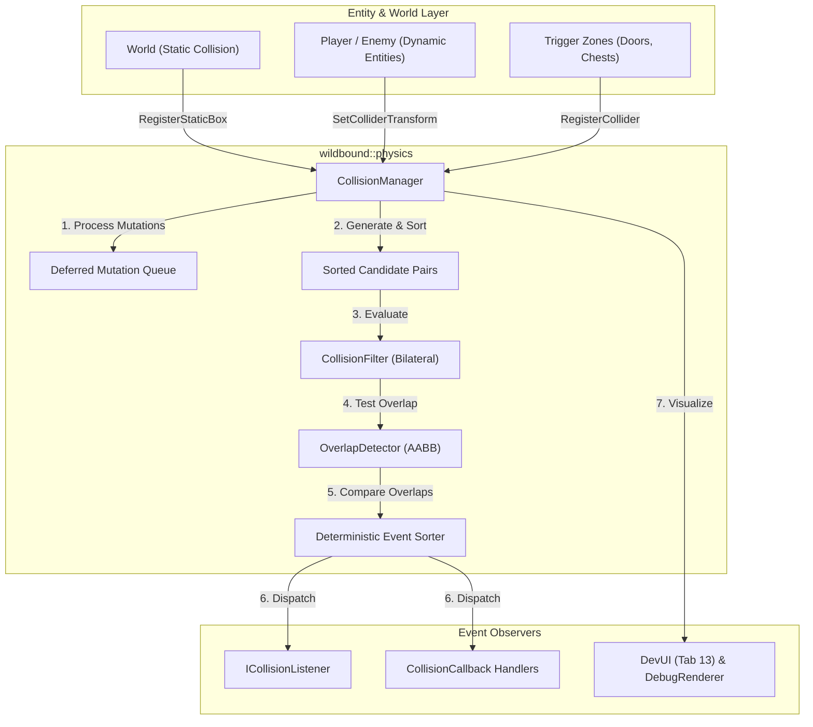

# Wildbound — Collision System Architecture Specification

> **Document ID**: `WB-SPEC-PHYS-001`  
> **Status**: APPROVED  
> **Date**: 2026-11-04  
> **Subsystem**: `wildbound::physics`  
> **Target Standard**: C++20 / raylib 5.5

---

## 1. Architectural Philosophy

Wildbound's collision architecture is engineered as a lightweight, modular, data-driven simulation layer designed for top-down 2D Battle Royale gameplay. It rejects monolithic physics engines (such as Box2D or Chipmunk) in favor of decoupled, zero-heap-overhead Axis-Aligned Bounding Box (AABB) mathematics and bitfield category filtering.

### Key Architectural Pillars:
1. **Decoupled Responsibilities**: Clear separation of collision representation, bilateral filtering, narrow-phase overlap detection, physical slide resolution, trigger volume tracking, and event dispatching.
2. **Deterministic Processing**: All candidate collider pairs and event dispatches follow a stable sorting order `(min(idA, idB), max(idA, idB))` independent of unordered container layout or runtime pointer values.
3. **Deferred Structural Mutations**: Modifications occurring inside collision callbacks (entity destruction, adding/removing colliders, toggling enabled state) are buffered in a deferred mutation queue and synchronized at discrete, safe ticks to prevent iterator invalidation and dangling references.
4. **Preservation of Established Systems**: Full backward compatibility with the existing `Player::ResolveMovement` axis-separated wall-sliding algorithms, `CombatSystem` hit detection, and `World` static geometry caches.

---

## 2. Component Taxonomy

```
src/physics/
├── CollisionTypes.hpp            // 10 Bitfield layers, bilateral mask defaults, collider types
├── CollisionFilter.hpp           // Bilateral filtering logic and self-collision prevention
├── OverlapDetector.hpp           // Pure mathematical AABB intersection, MTV penetration, point tests
├── Collider.hpp                  // Authoritative AABB collider representation (local offsets, layers)
├── CollisionEvent.hpp            // Event structures (Enter/Stay/Exit) and listener interfaces
├── TriggerVolume.hpp             // Dedicated component tracking entities inside trigger zones
├── CollisionManager.hpp          // Central coordinator, deferred queue, and simulation tick
├── CollisionManager.cpp          // Implementation of update pipeline, pair generation, queries
├── CollisionDebugRenderer.hpp    // Raylib diagnostic visualizer with layer color-coding
└── CollisionDebugRenderer.cpp    // Overlay rendering for physical boxes, triggers, overlaps
```

---

## 3. Class Interactions & Data Flow



---

## 4. Invariants & Guarantees

1. **No Circular Pair Testing**: For any two colliders $A$ and $B$, testing is conducted exactly once as pair `(min(A, B), max(A, B))`.
2. **Symmetric Filtering**: Two colliders interact if and only if both colliders' masks permit the other's layer:
   $$(A.\text{mask} \ \& \ B.\text{layer}) \ne 0 \quad \land \quad (B.\text{mask} \ \& \ A.\text{layer}) \ne 0$$
3. **Safe Reentrancy**: Event handlers executing during callback dispatch may safely invoke `UnregisterCollider`, `RegisterCollider`, or delete owning entities without memory corruption.
4. **Zero Per-Frame Allocation**: Candidate pairs, active overlaps, and event dispatch vectors utilize pre-reserved storage capacities to eliminate runtime heap thrashing.

