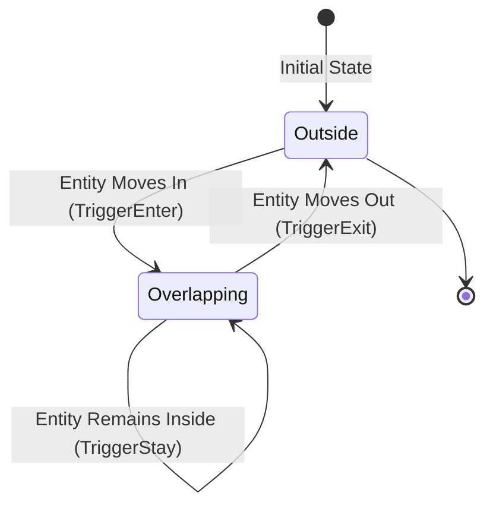

# Wildbound — Trigger Volume Specification

> **Document ID**: `WB-SPEC-PHYS-003`  
> **Status**: APPROVED  
> **Date**: 2026-11-04  
> **Subsystem**: `wildbound::physics`

---

## 1. Overview

A **Trigger Volume** is a non-blocking spatial region defined by an Axis-Aligned Bounding Box (AABB) classified as `ColliderType::Trigger`. Triggers do not exert physical forces, modify velocities, or generate penetration resolution. Their sole responsibility is observing entity entry, presence, and exit.

---

## 2. Trigger Lifecycle Events

The interaction between an entity and a trigger volume progresses through three deterministic states:



1. **`TriggerEnter`**: Dispatched on the exact simulation tick when an eligible entity collider intersects the trigger's world bounds after having not intersected it on the preceding tick.
2. **`TriggerStay`**: Dispatched on every subsequent consecutive simulation tick that the entity collider remains within the trigger's world bounds.
3. **`TriggerExit`**: Dispatched on the tick when an entity that was overlapping the trigger on the preceding tick is no longer overlapping (either due to movement, collider disabling, or unregistration).

---

## 3. Structural Properties of `TriggerVolume`

```cpp
class TriggerVolume {
public:
    TriggerVolume(ColliderId colliderId, EntityId ownerEntityId,
                  CollisionLayer layer = CollisionLayer::Trigger,
                  uint32_t mask = GetDefaultCollisionMask(CollisionLayer::Trigger),
                  Vector2 size = { 32.0f, 32.0f },
                  Vector2 offset = { 0.0f, 0.0f },
                  const std::string& name = "trigger_volume");

    bool IsEntityInside(EntityId entityId) const noexcept;
    size_t GetEntityCount() const noexcept;
    const std::unordered_set<EntityId>& GetEntitiesInside() const noexcept;
    // ...
};
```

### Characteristics:
- **Zero Physical Impassability**: Triggers return `IsTrigger() == true`. Movement systems like `Player::ResolveMovement` ignore triggers when calculating contact edges.
- **Multiple Overlaps**: A trigger volume simultaneously tracks arbitrary numbers of entities without data truncation.
- **Dynamic Transforms**: Dynamic triggers (e.g., mobile interaction zones attached to moving NPCs) follow parent transforms smoothly via `UpdatePosition(newPos)`.
- **Enabled / Disabled State**: Disabling a trigger volume automatically flushes active overlaps, triggering safe `TriggerExit` events for all resident entities on the subsequent tick.

