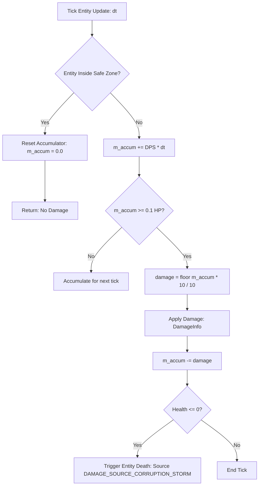

# Storm Damage System Specification

## 1. Authoritative Damage Model

The `wildbound::storm::StormDamageSystem` is responsible for calculating and applying penalty damage to any entity located outside the active safe perimeter.

### 1.1 Mathematical Formulation
Let:
- $\text{DPS}_k$ be the damage per second defined for current storm phase $k$.
- $\Delta t$ be the elapsed frame delta time in seconds.
- $m_{\text{accum}}$ be the fractional damage accumulator (`float`).
- $P$ be the entity world position, $C_{\text{safe}}$ the active safe zone center, and $R_{\text{safe}}$ the active safe zone radius.



### 1.2 Fractional Accumulator & Frame-Rate Independence
Because delta times $\Delta t$ vary depending on the rendering display rate (e.g., 33.3ms at 30 FPS, 16.6ms at 60 FPS, 8.3ms at 120 FPS), direct frame-by-frame rounding or truncating to integers causes severe discretization bias (and in low DPS phases, damage could be completely erased by integer casting).

The system accumulates fractional damage:
```cpp
m_damageAccumulator += dps * dt;
if (m_damageAccumulator >= 0.1f) {
    float applyAmount = std::floor(m_damageAccumulator * 10.0f) / 10.0f;
    m_damageAccumulator -= applyAmount;
    health->TakeDamage(applyAmount, DAMAGE_SOURCE_CORRUPTION_STORM);
}
```
This guarantees mathematical parity: over any duration $T$, $\int_0^T \text{Damage}(t)\, dt = \text{DPS} \cdot T$, regardless of frame rate fluctuations.

### 1.3 Damage Source Identification
All damage emitted by the system carries the distinct identifier:
```cpp
constexpr const char* DAMAGE_SOURCE_CORRUPTION_STORM = "DAMAGE_SOURCE_CORRUPTION_STORM";
```
This allows kill feeds, game summary screens, achievements, and combat loggers to recognize storm deaths as distinct from player, creature, or fall hazards.

### 1.4 Instant Cessation on Entry
The moment an entity's center or collision bounding box enters the safe boundary ($\|P - C_{\text{safe}}\| \le R_{\text{safe}}$), `m_damageAccumulator` is immediately cleared to `0.0f` and all damage application ceases on that exact frame.

