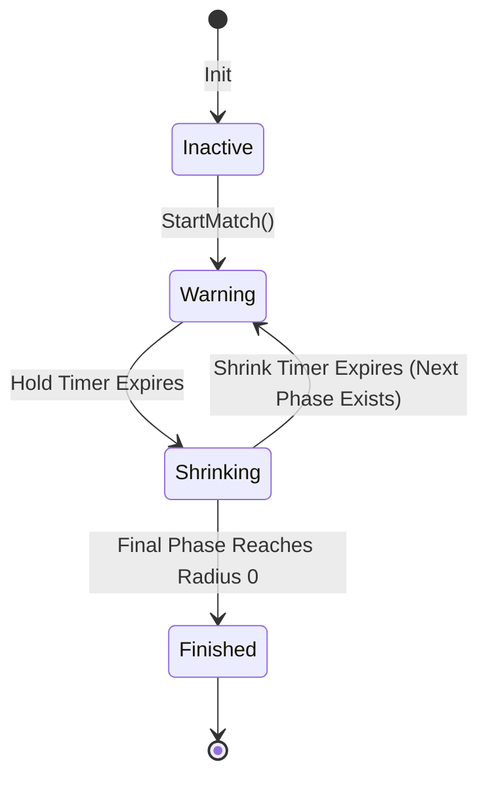

# Storm Phase Progression

## 1. Overview and Match Flow

The Corruption Storm progresses sequentially across a configurable series of stages (defaulting to 6 phases in `data/storm/storm_config.json`). Each phase consists of two sub-states:
1. **Warning / Hold Period**:
   - The current safe perimeter remains static.
   - The next target circle is calculated, rendered with a dashed pulsation, and projected on the Minimap.
   - A countdown warning timer is displayed on the HUD.
   - An audible alert sound (`sfx_storm_warning`) plays at the start and when 15 seconds remain.
2. **Shrinking Period**:
   - The current perimeter linearly interpolates ($t \in [0, 1]$) toward the target center and target radius:
     $$C(t) = (1 - t) \cdot C_{\text{start}} + t \cdot C_{\text{target}}$$
     $$R(t) = (1 - t) \cdot R_{\text{start}} + t \cdot R_{\text{target}}$$
   - Active contraction sound effect (`sfx_storm_shrink`) triggers.
   - Damage per second increases according to the phase configuration.

---

## 2. Default Phase Configuration Matrix

| Phase | Description | Hold Duration (s) | Shrink Duration (s) | Target Radius (px) | Damage / Sec (HP) | Max Center Drift Ratio |
|---|---|---|---|---|---|---|
| **Phase 1** | Initial Island Contraction | 120.0 | 90.0 | 2800.0 | 1.0 HP/s | 0.40 |
| **Phase 2** | Secondary Sector Enclosure | 90.0 | 75.0 | 1800.0 | 2.0 HP/s | 0.50 |
| **Phase 3** | Mid-Match Convergence | 75.0 | 60.0 | 1000.0 | 4.0 HP/s | 0.60 |
| **Phase 4** | Late-Match Escalation | 60.0 | 45.0 | 500.0 | 7.0 HP/s | 0.70 |
| **Phase 5** | Endgame Circle | 45.0 | 30.0 | 200.0 | 10.0 HP/s | 0.80 |
| **Phase 6** | Final Total Collapse | 30.0 | 30.0 | 0.0 | 15.0 HP/s | 0.00 |

Total Match Duration: ~10 minutes (655 seconds).

---

## 3. State Machine Transitions

- **Early Phase Skip**: For debugging and rapid testing, developers can instantly skip the current timer or jump directly to arbitrary phases via `StormManager::SkipToNextPhase()` or `DevUI` Tab 19.
- **Pause / Resume**: The storm manager respects the global game pause state and provides independent developer pause toggles.

