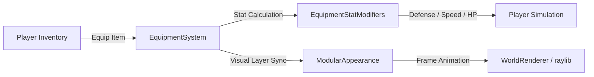

# Equipment System Architecture — Wildbound Phase 24

## 1. Overview & Architectural Role

The `EquipmentSystem` (`src/entities/EquipmentSystem.hpp`, `.cpp`) manages the physical and stat-granting gear worn by humanoid combatants (players and NPCs). It decouples item storage (owned by `Inventory`) from active equipped state, computes aggregate defensive and offensive modifiers, and synchronizes visual cosmetics with `ModularCharacter`.



---

## 2. Equipment Slots & Data Contracts

Each slot in the 8-slot array (`m_slots`) stores an `EquippedItem` instance:

```cpp
struct EquippedItem {
    std::string itemId;                     // Definition ID (e.g. "arm_iron_plate_001")
    items::ItemRarityTier rarityTier{items::ItemRarityTier::Common};
    float defenseValue{0.0f};               // Armor / protection rating
    float durability{100.0f};
    std::unique_ptr<weapons::WeaponInstance> weaponInstance{nullptr}; // Attached runtime weapon instance
};
```

### Supported Slots
1. `EquipmentSlot::MainHand` — Primary weapon.
2. `EquipmentSlot::OffHand` — Secondary weapon, offhand dagger, or shield.
3. `EquipmentSlot::Head` — Headgear granting defense and cosmetic head coverage.
4. `EquipmentSlot::Chest` — Body armor providing principal physical mitigation.
5. `EquipmentSlot::Legs` — Greaves and trousers granting armor and speed adjustments.
6. `EquipmentSlot::Feet` — Boots modifying movement speed and terrain traction.
7. `EquipmentSlot::Face` — Masks, eye wear, or decorative facial equipment.
8. `EquipmentSlot::Back` — Capes, backpacks expanding inventory, or quivers.

---

## 3. Equipping & Unequipping Transactions

```cpp
bool EquipmentSystem::Equip(const std::string& itemId, const items::ItemManager& itemMgr, Player* player);
bool EquipmentSystem::Unequip(EquipmentSlot slot, Player* player);
```

When `Equip` is called:
1. `itemMgr.GetItem(itemId)` retrieves metadata.
2. The slot is deduced:
   - `ItemCategory::Weapon` $\to$ `MainHand` (or `OffHand` if `MainHand` occupied).
   - `ItemCategory::Armor` $\to$ matched based on item prefix (`arm_head_` $\to$ Head, `arm_chest_` $\to$ Chest, etc.).
   - `ItemCategory::Clothing` $\to$ mapped to appropriate body slot.
3. If the slot is currently occupied, the existing item is unequipped and returned to inventory.
4. A `WeaponInstance` is manufactured if the item is a weapon:
   `weapons::WeaponManager::GetInstance().CreateInstance(itemId, rarity)`.
5. `RecalculateStats()` updates all modifier caches.
6. Modular character appearance is synced to display the equipped sprite.

