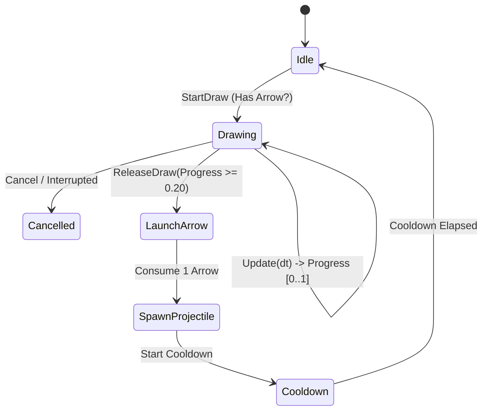

# Ranged Weapon and Projectile Specification — Wildbound Phase 24

## 1. Overview & Mechanics

Ranged combat in Wildbound centers on bows that require physical arrows, dynamic charge-and-release draw mechanics, trajectory ballistics, and scaling velocity/damage based on draw tension.

### Key Principles
1. **Dynamic Draw Cycle**: Holding the attack input begins drawing the bowstring. Drawing progresses from 0.0 to 1.0 over `drawDuration` seconds.
2. **Charge-Scaled Damage & Velocity**:
   $$\text{Damage} = \text{EffectiveBaseDamage} \times (0.35 + 0.65 \times \text{DrawProgress})$$
   $$\text{Velocity} = \text{stats.projectileSpeed} \times (0.50 + 0.50 \times \text{DrawProgress})$$
3. **Minimum Tension Threshold**: An arrow must be charged to at least 20% ($progress \ge 0.20$) to launch with effective lethality. Firing before 20% results in a low-damage fizzle.
4. **Physical Ammunition Requirement**: Firing consumes 1 arrow from inventory (`arrow_iron_001` or any ammo item). If no ammunition is available, the bow cannot be drawn or fired.



---

## 2. Bow Draw Lifecycle in `WeaponController`

```cpp
void WeaponController::StartDraw() {
    if (m_isDrawing || !CanAttack()) return;
    m_isDrawing = true;
    m_drawTimer = 0.0f;
    m_attackState = WeaponAttackState::Windup;
}

float WeaponController::ReleaseDraw() {
    if (!m_isDrawing) return 0.0f;
    m_isDrawing = false;
    float progress = GetDrawProgress(); // min(1.0, m_drawTimer / drawDuration)
    m_drawTimer = 0.0f;
    m_attackState = WeaponAttackState::Recovery;
    m_stateTimer = 0.0f;
    return progress;
}
```

---

## 3. Projectile Ballistics & Integration

When `ReleaseDraw` triggers:
1. Attacker checks inventory for ammunition: `player->GetInventory()->FindItem("arrow_iron_001")`.
2. Arrow is deducted: `player->GetInventory()->RemoveItem("arrow_iron_001", 1)`.
3. Projectile is spawned via `ProjectileSystem::SpawnProjectile`:
   - `origin`: Attacker muzzle / bow anchor position.
   - `direction`: Unit vector toward aim crosshair.
   - `speed`: `stats.projectileSpeed * (0.5f + 0.5f * progress)`.
   - `damage`: `effectiveDamage * (0.35f + 0.65f * progress)`.
   - `maxDistance`: `stats.reach * (0.6f + 0.4f * progress)`.
   - `ownerId`: Attacker entity ID.
4. On collision with enemy hitbox, `CombatSystem::ProcessAttack` resolves projectile impact damage, applying critical chance multipliers.

