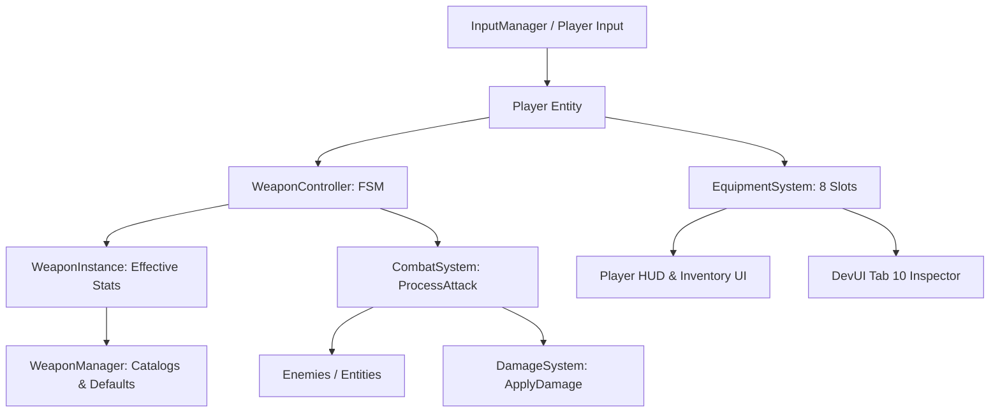

# Weapon System Architecture — Wildbound Phase 24

## 1. Overview & System Mission

The Wildbound Weapon System provides a modular, data-driven combat and equipment infrastructure for the 2D top-down fantasy battle royale. It bridges low-level player input and character control with high-level combat resolution, inventory management, equipment stat scaling, and presentation layers (raylib rendering, UI widgets, ImGui dev tools).

The weapon architecture enforces a strict single source of truth:
* **Definitions**: Canonical immutable weapon parameters and base statistics loaded from data/AMS catalogues.
* **Instances**: Runtime items (`WeaponInstance`) encapsulating rarity modifiers, effective damage/crit metrics, and durability/identity links.
* **Controller**: Finite state machine (`WeaponController`) governing attack execution phases (Prep $\to$ Active $\to$ Recovery $\to$ Cooldown), bow charge cycles, attack cadence, and one-hit-per-target swing deduplication.
* **Combat Integration**: Seamless coupling with `CombatSystem`, `Combatant`, and `DamageSystem` for deterministic damage calculation, mitigation, and hit registration.

---

## 2. Component Hierarchy

### 2.1 WeaponData (`src/weapons/WeaponData.hpp`)
Defines the core data contracts and enums:
* `WeaponType`: `Melee`, `Ranged`, `Magic`, `Shield`.
* `WeaponRarity`: `Common`, `Uncommon`, `Rare`, `Epic`, `Legendary`, `Mythic`.
  - Scaled by `GetRarityDamageMultiplier(rarity)`: Common (1.00x), Uncommon (1.05x), Rare (1.10x), Epic (1.15x), Legendary (1.20x), Mythic (1.25x).
  - Associated with HUD color palette (`GetRarityColor`).
* `WeaponStats`: Core mechanical parameters including base damage, attack speed, cooldown, reach/range, critical chance & multiplier, stamina cost, swing arc angle, draw duration (bows), and projectile launch velocity.
* `WeaponAttackState`: Discrete states representing the attack lifecycle:
  - `Idle`: Ready for input.
  - `Windup` / `Prep`: Attack initiated, anticipation frames playing, swing cannot yet hit.
  - `Active`: Hitbox is active, cleaving targets, single-hit tracking active.
  - `Recovery`: Follow-through motion, weapon hitbox inactive.
  - `Cooldown`: Recovery completed, awaiting cadence cooldown timer before next attack can start.

### 2.2 WeaponInstance (`src/weapons/WeaponInstance.hpp`, `.cpp`)
Runtime encapsulation of an equipped or inventory weapon:
* References the base item ID and canonical definition.
* Maintains instance-level `WeaponRarity`.
* Calculates effective statistics dynamically:
  $$\text{EffectiveDamage} = \text{round}(\text{baseDamage} \times \text{RarityMultiplier})$$
  $$\text{EffectiveCritChance} = \text{baseCritChance} + (\text{RarityTier} \times 0.01)$$
* Preserves definition integrity without mutating global config tables.

### 2.3 WeaponController (`src/weapons/WeaponController.hpp`, `.cpp`)
State machine managing weapon attack progression and target filtering:
* **Attack Lifecycle**: Advances through Prep $\to$ Active $\to$ Recovery $\to$ Cooldown using delta time.
* **Multi-Target Single-Hit Tracking**: `m_targetsHitThisSwing` (`std::unordered_set<uint64_t>`) ensures a sweeping melee arc hits every target in range exactly once per swing.
* **Bow Draw Progression**: Manages `StartDraw()`, `Update(dt)`, and `ReleaseDraw()` returning charge ratio $[0.0, 1.0]$.
* **Switching Guards**: `CanSwitchWeapon()` blocks weapon hot-switching during prep, active swing, recovery, or active bow draw.

### 2.4 WeaponManager (`src/weapons/WeaponManager.hpp`, `.cpp`)
Central repository and factory:
* Loads canonical weapon definitions from `assets/definitions/weapons.json` (or initializes built-in hardcoded defaults for all 11 catalog weapons).
* Provides catalog query methods: `GetWeaponStats(id)`, `GetWeaponType(id)`, `GetDefaultRarity(id)`.
* Factory helper `CreateInstance(id, rarity)` creating fully initialized `WeaponInstance`s.

---

## 3. Combat Integration Flow

1. **Triggering Attack**:
   - Primary fire / `Action::Attack` triggers `Player::PerformMeleeAttack()` or `Player::StartBowDraw()`.
   - `WeaponController::StartAttack()` transitions state from `Idle` to `Windup`.
2. **Hit Registration**:
   - When state enters `Active`, melee hitbox query detects overlapping combatants.
   - For each detected target, `attacker->HasHitTargetThisAttack(targetId)` is checked.
   - If target was not yet hit, `CombatSystem::ProcessAttack` applies scaled damage, invokes damage events, and records `attacker->RecordHitTargetThisAttack(targetId)`.
3. **Recovery & Cooldown**:
   - Attack completes active frames, transitions to `Recovery`, then `Cooldown`.
   - Clears `m_targetsHitThisSwing` on new attack initiation.

---

## 4. Architectural Boundaries

* **No Modern Firearms**: Wildbound only implements fantasy weapons (swords, bows, arrows, shields, staves).
* **No Durability Degradation**: Weapons do not break or degrade over time in simulation.
* **Local Simulation Focus**: Pure C++ deterministic state updates without networking protocol overhead.

