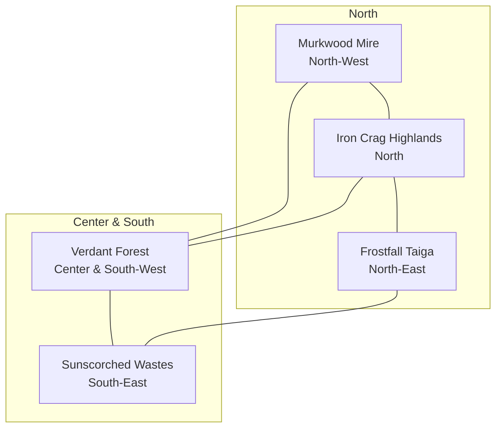

# Wildbound — Biome Distribution

## 1. Overview & Regional Matrix

The Isle of Wildbound features five interconnected biomes, each possessing distinct ground terrain, vegetation profiles, environmental structures, atmospheric properties, and audio soundscapes.

---

## 2. Biome Regional Specifications

### 2.1 Verdant Forest (Heartland)
- **World Bounds**: $[X: 1920.0, Y: 3840.0, W: 4480.0, H: 4480.0]$
- **Primary Settlement**: Greenwood Village $(X: 4160, Y: 5920)$
- **Key POIs**: Ancient Citadel Fortress $(X: 5120, Y: 4800)$, Forgotten Forest Shrine $(X: 3200, Y: 6800)$, Hunter's Camp $(X: 4160, Y: 6800)$.
- **Terrain Profile**: Vibrant temperate grass, packed loam highways, mossy stream banks.
- **Vegetation**: `tree_oak_001..004`, `tree_pine_001..002`, `bush_dense_001`, `flower_wildflower_001`.
- **Audio Ambience**: `amb_forest_day`, `amb_forest_night`, flowing river currents, songbirds.

### 2.2 Sunscorched Wastes (Desert)
- **World Bounds**: $[X: 5440.0, Y: 4960.0, W: 3840.0, H: 3840.0]$
- **Primary Settlement**: Sunfall Outpost $(X: 7680, Y: 7520)$
- **Key POIs**: Sunfall Oasis & Bazaar $(X: 7680, Y: 6720)$, Buried Temple of the Sun God $(X: 7200, Y: 6400)$.
- **Terrain Profile**: Shifting wind-rippled dunes, baked clay flats, sandstone bedrock.
- **Vegetation**: Arid thorny scrub, desert flat rocks, weathered sandstone boulders.
- **Audio Ambience**: `amb_desert_wind`, dry whistling wind gusts, heat haze.

### 2.3 Frostfall Taiga (Snow)
- **World Bounds**: $[X: 6400.0, Y: 800.0, W: 3200.0, H: 3840.0]$
- **Primary Settlement**: Frostpeak Village $(X: 7840, Y: 2560)$
- **Key POIs**: Frostfall Expedition Camp $(X: 6800, Y: 3400)$, Frostpeak Glacial Cavern $(X: 7200, Y: 2200)$.
- **Terrain Profile**: Fresh powder snowdrifts, packed snow highways, glacial ice sheets.
- **Vegetation**: Snow-dusted spruce, tall alpine pines, freezing granite ledges.
- **Audio Ambience**: `amb_snow_blizzard`, howling wind, crunching snow footsteps.

### 2.4 Murkwood Mire (Swamp)
- **World Bounds**: $[X: 960.0, Y: 1120.0, W: 3040.0, H: 3360.0]$
- **Primary Settlement**: Mirewood Settlement $(X: 2400, Y: 2720)$
- **Key POIs**: Drowned Mire Ruins $(X: 3000, Y: 3800)$, Duckboard Crossing $(X: 2400, Y: 3600)$.
- **Terrain Profile**: Mud peat banks, stagnant shallow algae pools, deep impassable bog void.
- **Vegetation**: Hollow rotten stumps, luminescent fungi clusters, cattail reeds, decaying oak logs.
- **Audio Ambience**: `amb_swamp_murk`, water droplets, croaking frogs, damp mist.

### 2.5 Iron Crag Highlands (Mountain)
- **World Bounds**: $[X: 3520.0, Y: 800.0, W: 3200.0, H: 3040.0]$
- **Primary Settlement**: Highstone Village $(X: 5120, Y: 2080)$
- **Key POIs**: Highstone Mine & Cave Archway $(X: 4400, Y: 2080)$, Iron Crag Chasm Bridge $(X: 5120, Y: 3360)$.
- **Terrain Profile**: Solid stepped granite terraces, alpine heather ridges, scree slopes, iron veins.
- **Vegetation**: High-altitude pines, massive basalt boulders, scree rocks.
- **Audio Ambience**: `amb_mountain_peaks`, roaring waterfalls, echoing canyon wind.

