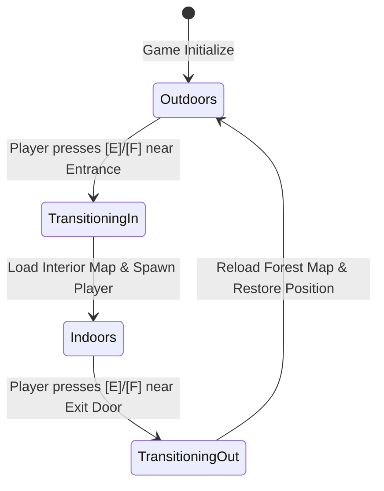

# Wildbound — Building and Interior Transition Architecture

**Subsystem:** `wildbound::world::BuildingManager`  
**C++ Standard:** C++20  
**Engine Integration:** raylib 5.5, `World`, `Tilemap`, `MapLoader`, `Camera2DSystem`, `Player`

---

## 1. Architectural Philosophy

In top-down 2D games, handling indoor/outdoor transitions reliably and efficiently is a fundamental design challenge. Wildbound adopts an **Interior Map Transition Architecture** for the following architectural advantages:
1. **Zero Exterior Bleed:** Dedicated interior maps provide 100% isolated rendering, custom ambient lighting, and bespoke wall geometries without visual clipping into outdoor terrain.
2. **Dynamic Camera Bounding:** Interior camera boundaries automatically clamp to the specific interior map dimensions (e.g. $640 \times 480$ px), centering the view on the room without displaying black void or jarring camera pans.
3. **Optimized Spatial Indexing:** Outdoor collision trees (2,284 bounds) are unloaded, and high-density interior collision trees (~100 bounds) are loaded instantaneously in under 1 millisecond.
4. **Deterministic Return State:** The player's exact exterior position is cached prior to entering, guaranteeing seamless return directly outside the entrance threshold upon exit.

---

## 2. Core Data Structures & Types

### 2.1 `Building` Struct (`src/world/BuildingData.hpp`)

```cpp
namespace wildbound::world {

struct Building {
    std::string id;                         // Unique identifier (e.g. "village_general_store")
    std::string name;                       // User-facing display title ("Greenwood Supplies & Sundries")
    std::string buildingType;               // Exterior asset texture key ("shop_general_001")
    std::string district;                   // Village sector ("Commercial District")
    Rectangle exteriorBounds;               // Exterior footprint in world coordinates (X, Y, W, H)
    Vector2 entrancePosition;               // Exterior doorway interaction coordinate
    float entranceRadius = 32.0f;           // Proximity trigger radius (px)
    bool isEnterable = false;               // True if interior map is defined and functional
    std::string interiorMapPath;            // Relative path to Tiled JSON interior map
    Vector2 interiorSpawnPosition;          // Spawn coordinates inside interior
    Vector2 interiorExitPosition;           // Exit doorway trigger coordinates inside interior
    Vector2 exteriorReturnPosition;         // Exterior placement coordinate upon exit
    std::string description;                // Lore and gameplay description

    bool IsInEntranceRange(const Vector2& pos) const;
    bool IsInExitRange(const Vector2& pos) const;
};

}
```

---

## 3. `BuildingManager` Subsystem (`src/world/BuildingManager.hpp`)

`BuildingManager` acts as the single source of truth for village settlements, building queries, proximity detection, and map transition lifecycles.



### 3.1 Public Interface

| Method | Return Type | Description |
| :--- | :--- | :--- |
| `Initialize(catalogPath, defaultExteriorMap)` | `bool` | Parses `data/buildings/village_buildings.json` and prepares catalog. |
| `GetBuilding(id)` | `const Building*` | Queries building metadata by unique ID. |
| `FindNearestBuilding(pos, maxDist)` | `const Building*` | Finds nearest building entrance within Euclidean distance. |
| `IsIndoors()` | `bool` | Returns true if currently inside an interior map. |
| `GetCurrentInteriorBuilding()` | `const Building*` | Returns active interior building definition, or null if outdoors. |
| `CheckEntrancePrompt(playerPos)` | `const Building*` | Returns enterable building pointer if player is within door radius outdoors. |
| `CheckExitPrompt(playerPos)` | `bool` | Returns true if player is within exit doorway radius indoors. |
| `EnterBuilding(id, world, player, cam, am)` | `bool` | Executes complete outdoor-to-indoor transition. |
| `ExitBuilding(world, player, cam, am)` | `bool` | Executes complete indoor-to-outdoor transition. |

---

## 4. Transition Lifecycle & Execution Flow

### 4.1 Entering a Building
1. **Pre-condition Validation:**
   - Verify player is currently outdoors (`m_isIndoors == false`).
   - Query building by ID, assert `b->isEnterable == true` and `b->interiorMapPath` is non-empty.
2. **Exterior State Caching:**
   - Cache player's current exterior coordinates into `m_savedExteriorPlayerPos`.
3. **Map Loading:**
   - Call `world.LoadMap(b->interiorMapPath, assetMgr)`.
   - `World` unloads the exterior map and instantiates the interior `Tilemap`.
   - Rebuilds spatial collision cache for interior walls, counters, and props.
4. **Player & Camera Setup:**
   - Move player: `player.Spawn(b->interiorSpawnPosition)`.
   - Update camera bounds: `camera.SetWorldBounds(world.GetWorldBounds())`.
   - Reset camera tracking: `camera.SetTarget(b->interiorSpawnPosition); camera.SetFollowTarget(b->interiorSpawnPosition);`.
5. **State Finalization:**
   - Set `m_isIndoors = true; m_currentInteriorId = b->id;`.

### 4.2 Exiting a Building
1. **Pre-condition Validation:**
   - Verify player is currently indoors (`m_isIndoors == true`).
2. **Return Coordinate Resolution:**
   - Prefer `b->exteriorReturnPosition` if defined; fallback to `m_savedExteriorPlayerPos`.
3. **Exterior Map Reload:**
   - Call `world.LoadMap(m_exteriorMapPath, assetMgr)` (`maps/forest/forest_01.json`).
   - Rebuilds exterior collision cache (2,284 bounds).
4. **Player & Camera Restoration:**
   - Move player: `player.Spawn(returnPos)`.
   - Update camera bounds: `camera.SetWorldBounds(world.GetWorldBounds())` ($5120 \times 3840$ px).
   - Reset camera tracking to return position.
5. **State Finalization:**
   - Set `m_isIndoors = false; m_currentInteriorId.clear();`.

---

## 5. Input & UI Integration

* **Input Mapping:**
  - Interaction Key: **`E`** or **`F`** (`KEY_E`, `KEY_F`).
  - Entering: Checked in `Game::ProcessInput` when `m_buildingManager->CheckEntrancePrompt(playerPos) != nullptr`.
  - Exiting: Checked in `Game::ProcessInput` when `m_buildingManager->CheckExitPrompt(playerPos) == true`.
* **In-Game Dynamic HUD Prompt:**
  - In `Game::Render` (UI Pass), when near an entrance or exit door, a styled gold-bordered prompt box appears at the bottom-center of the screen:
    - Outdoors: `"Press [E] or [F] to Enter <Building Name>"`
    - Indoors: `"Press [E] or [F] to Exit <Building Name>"`
* **Developer Suite (DevUI Tab 3):**
  - Section 6: **"Greenwood Village Buildings & Interiors"** lists all 13 buildings.
  - One-click buttons:
    - `"Teleport Outside"`: Instantly places the player at the building's exterior door.
    - `"Enter Interior"`: Instantly loads the interior and spawns the player inside.
    - `"Exit to Exterior"`: Instantly restores the exterior map.

